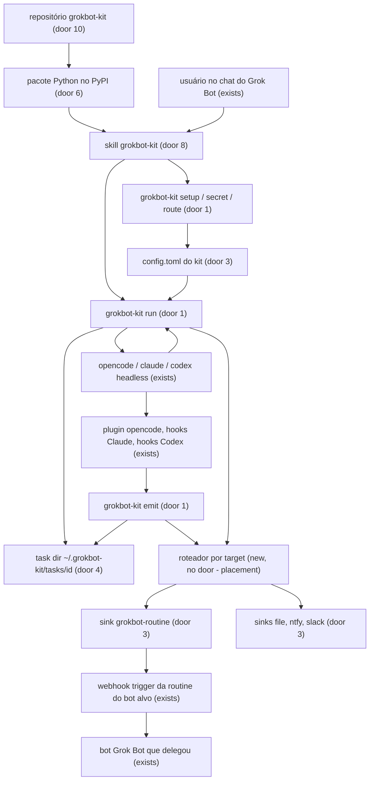
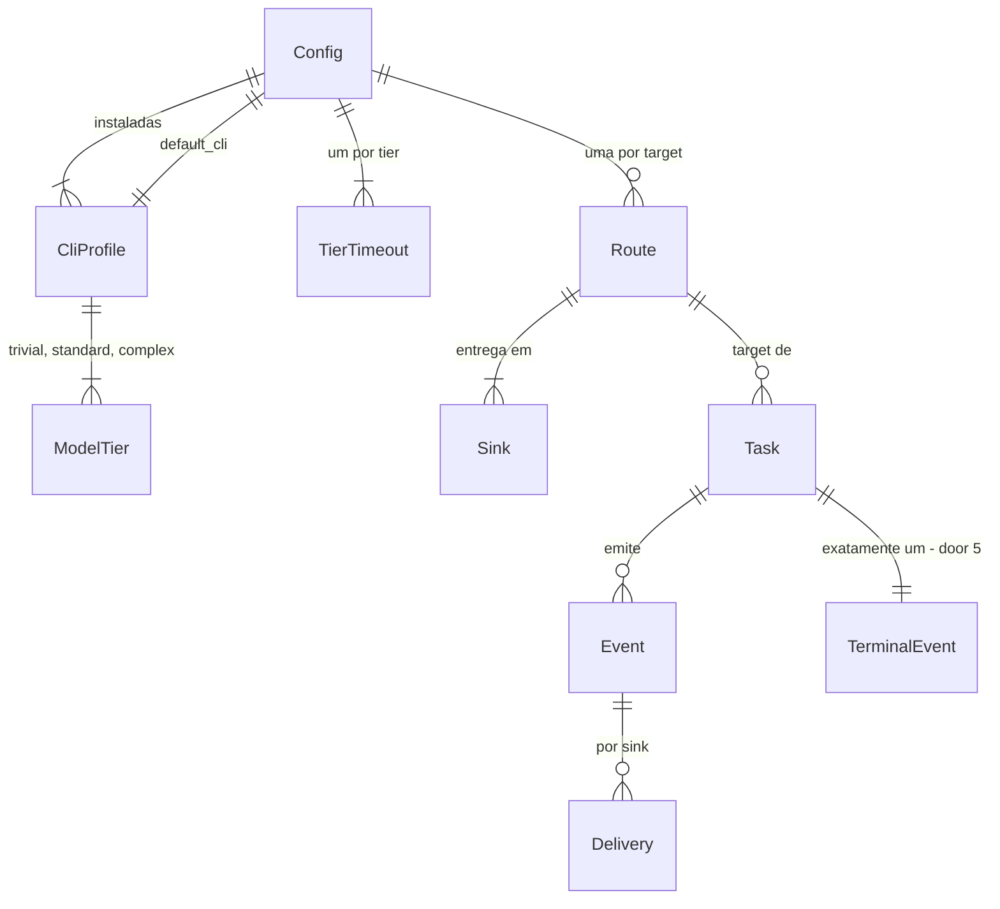

# Kit de integração Grok Bot - v1: delegar tarefas a agentes headless e acordar a routine do bot certo

> Nome do projeto: **`grokbot-kit`** (decidido em 18/10/2026). Executável `grokbot-kit`, pacote Python
> `grokbot-kit` (módulo `grokbot_kit`), env `GROKBOT_KIT_*`, diretórios `~/.grokbot-kit/` e
> `~/.config/grokbot-kit/`, schema `grokbot-kit.event/v1`, skill `grokbot-kit`, repositório
> `rodrigo-pasini/grokbot-kit`. O repositório local `grokbot-kit` já existe (commits `79f430f` e `0c3e4a2`, sem
> remote); o remoto ainda não existe e será criado a partir dele pelo agente local do Rodrigo com `gh`. Licença MIT. Linguagem Python.

## Problem

Os bots Grok Bot do Rodrigo delegam tarefas longas a agentes de código headless (opencode, Claude Code,
Codex) no box compartilhado. Enquanto a tarefa roda, o bot que delegou hiberna, e nada o acorda: ninguém
fica sabendo quando a tarefa termina, quando falha, nem quando ela esbarrou numa permissão. O resultado só
aparece quando o Rodrigo pergunta, e o trabalho fica parado nesse meio-tempo.

O código de saída também não diz se a tarefa foi feita. Evidência das pesquisas de 18/10/2026 no box:

- `opencode run` 1.19.3 saiu com `0` depois de o modelo responder "done" sem ter rodado o comando; e, sem
  `< /dev/null`, ficou travado sem saída até o `timeout 150` matar (exit `124`).
- `claude -p` 2.1.300 saiu com `0` e `subtype: "success"` com `permission_denials` não vazio.
- `codex exec` 0.163.0 força `approval_policy = Never` e rejeita toda aprovação (fonte
  `codex-rs/exec/src/lib.rs`); só sai com `1` em `turn.failed`/`error`.

Hoje cada bot que quer usar um desses agentes também precisa redescobrir como instalar, fazer login,
escolher modelo e lançar cada CLI; nada disso é portável para os Grok Bots de outras pessoas. E o projeto
ainda não tem repositório: sem licença, empacotamento e CI definidos antes do código, cada contribuição
começa sem chão comum.

Não há números de volume (quantas tarefas se perdem por semana); a fonte não traz.

Quando o v1 sair:

- existe um repositório público `grokbot-kit` com licença MIT, pacote Python instalável com `uv tool
  install`, CI e release automatizados, e este plano versionado em `docs/.specs/`;
- o bot que delegou recebe na **sua própria routine** um evento com o que precisa para agir - qual tarefa,
  onde (cwd/repo), como terminou e por quê, resumo, onde ler log/transcript, e como retomar - e é acordado
  também quando o agente esbarrou numa permissão; os outros bots não são acordados;
- qualquer Grok Bot que receba a skill `grokbot-kit` consegue, numa primeira conversa, instalar o kit e as
  CLIs que o usuário escolher, guiar o login, definir a CLI padrão, criar a rota para a sua routine e,
  depois, delegar tarefas escolhendo CLI e modelo por custo/benefício.

O projeto é um **kit de integração com o Grok Bot**. A única interface Grok Bot usada é o **webhook trigger
de routine** (`POST https://api2.cursor.sh/automations/webhook/<routine-uuid>` com `Authorization: Bearer crsr_…`, URL e key copiadas do painel da routine; o header não chega ao agente, então o bot nunca vê a key - verificado em 18/10/2026).
Outras capacidades esperam uma interface documentada (Out of scope).

## Flow

Reusa o mecanismo nativo de cada ferramenta (plugin do opencode, hooks do Claude via `--settings`, hooks
inline do Codex via `-c` num `CODEX_HOME` isolado), o login oficial de cada CLI, o webhook trigger de
routine do Grok Bot (exists), e `uv`, GitHub Actions e PyPI para empacotar e publicar (exists); não
reimplementa nenhum deles.

Leitura do caminho:

0. Fundação (S0): o agente local do Rodrigo, com `gh` autenticado, confere as precondições, acrescenta o scaffold ao repositório local existente (histórico preservado), cria `rodrigo-pasini/grokbot-kit` a partir dele e aplica a constituição da door 11 (configurações, proteção da `main`, segurança, environment `pypi`); o repositório (door 10) chega ao remoto com LICENSE MIT, `pyproject.toml` com `uv`, lint, tipos, testes, CI e release; o release publica o pacote (door 6) no PyPI.
1. Primeiro uso: a skill (door 8) instala o kit com `uv tool install`, pergunta quais CLIs instalar, instala, guia o login, pede a CLI padrão, descobre os modelos de cada CLI e grava tudo no config (door 3) via comandos `grokbot-kit` (door 1). Segredos entram por `grokbot-kit secret set`, nunca pelo chat.
2. A skill guia a criação da routine com webhook trigger no Grok Bot (exists) e grava a rota do bot com `grokbot-kit route add`; `route test` confirma a entrega.
3. Na tarefa: a skill escolhe CLI (pedida ou padrão) e modelo (pedido, ou tier pela classificação da tarefa) e chama `grokbot-kit run`. O wrapper valida rota e modelo antes de lançar, resolve o timeout pelo tier, cria o task dir (door 4) e lança o agente com stdin em `/dev/null` e saída JSON.
4. Durante a tarefa, os hooks/plugin (exists) chamam `grokbot-kit emit` só com `GROKBOT_KIT_TASK_ID` no ambiente; o emit grava no task dir e envia `needs_input` na hora.
5. out: quando o agente termina, o wrapper deriva o status e envia **um** evento terminal (door 2); o roteador (new, no door - placement) entrega aos sinks da rota do `target`, e o sink `grokbot-routine` (door 3) acorda o bot que delegou. O que não foi entregue fica em `undelivered.jsonl` para `grokbot-kit redeliver`.

## Impact

| Front | What changes |
| --- | --- |
| repositório | o repositório local existente (`79f430f`, `0c3e4a2`: `CLAUDE.md`, `.claude/`, `.agents/`, `.gitignore`, `docs/`) recebe o scaffold por cima, sem reescrever o histórico e mantendo `.claude/` e `.agents/` versionados, e vira o novo repositório público `rodrigo-pasini/grokbot-kit` no GitHub, criado pelo agente local do Rodrigo com `gh`, com CI, release, proteção da `main`, alertas e updates de segurança do Dependabot, secret scanning e environment `pypi`; este plano já vive em `docs/.specs/`; a cópia de leitura gerada `docs/SPEC.md` fica fora do git (`.gitignore`) |
| distribuição | novo pacote `grokbot-kit` no PyPI (nome livre em 18/10/2026), publicado por trusted publishing |
| domain | novo termo: `task` - uma execução de agente lançada por `grokbot-kit run`, identificada por `task_id`, vive no task dir |
| domain | novo termo: `target` - o bot Grok Bot que delegou e deve ser acordado; 1:1 com uma rota no config |
| domain | novo termo: `route` - lista de sinks de um `target`; o sink principal é a routine daquele bot |
| domain | novo termo: `tier` - classe de tarefa (`trivial`, `standard`, `complex`) que mapeia para uma lista ordenada de modelos por CLI e para um timeout |
| domain | novo termo: `default_cli` - a CLI usada quando a tarefa não pede outra |
| config do usuário | `~/.config/opencode/plugins/grokbot-kit.ts` criado por `install opencode` (inativo fora de uma task); Codex usa um `CODEX_HOME` próprio em `~/.grokbot-kit/codex-home` com login próprio; `~/.claude/settings.json` e `~/.codex/` não são tocados |
| ambiente Python do box | o kit vive no ambiente isolado do `uv tool` (`~/.local/share/uv/tools/grokbot-kit/`) com Python gerenciado pelo `uv`; nenhum pacote é instalado no Python do sistema nem num venv compartilhado |
| CLIs instaladas | o setup instala no box as CLIs escolhidas pelo usuário pelos instaladores oficiais; nada é desinstalado sem pedido |
| stored data | nada a migrar - projeto novo |
| box compartilhado | todos os bots do usuário compartilham o box; o config é um só, com uma rota por bot; cada task tem dir próprio |

## Relations

One-way constraints: um único evento terminal por `task` (door 5); chave de dedupe
`<task_id>:<event>:<discriminator>` única por task dir (door 5); `target` precisa existir em `routes`
antes do agente ser lançado (door 3); `default_cli` precisa estar entre as CLIs instaladas (door 3); todo id de
modelo num tier precisa ter vindo da descoberta daquela CLI (door 3). No columns and no types here.

## Surface

Rotas com contrato HTTP. O receptor principal é a routine do Grok Bot; a resposta dela decide o retry.

| Route | In | Out | Status |
| --- | --- | --- | --- |
| `POST https://api2.cursor.sh/automations/webhook/<routine-uuid>` (sink `grokbot-routine`; URL do campo "POST para" do painel) | `Authorization: Bearer crsr_<hex>`, `Content-Type: application/json`, `User-Agent: grokbot-kit/<versão>`, corpo JSON `grokbot-kit.event/v1`; a routine recebe o envelope `{headers, body, body_digest, timestamp_ms}` com `body` como texto cru e só `content-type`, `user-agent` e `x-request-id` repassados | `200` `{"success":true,"runUuid":"<uuid>"}`; `401` `{"code":"error","message":"Missing Authorization header. Use Authorization: Bearer <key>."}` | `200`-`299` com `success: true` e `runUuid` entregue (guarda `runUuid`), sem eles falha sem retry; `401` key ausente ou inválida, falha sem retry; `429` e `500`-`599` retry; `400`, `403`, `404` e demais 4xx falha sem retry |
| `grokbot-kit run [--tool opencode/claude/codex] [--model <id>] [--tier trivial/standard/complex] --target <t> --label <l> [--timeout <dur>] [--cwd <dir>] [--prompt-file <f>] [-- <prompt>]` | prompt, config | evento terminal nos sinks; caminho do task dir em stderr | exit = exit do agente; `124` timeout; `130` interrompido; `2` uso/config inválido; `127` CLI não encontrada |

Comandos sem contrato HTTP (exit codes):

| Comando | In | Out | Exit |
| --- | --- | --- | --- |
| `grokbot-kit emit --from opencode/claude/codex` | JSON do hook em stdin, `GROKBOT_KIT_*` no env | registro no task dir; `needs_input` nos sinks | sempre `0` |
| `grokbot-kit redeliver <task_id>` | `undelivered.jsonl` do task dir | eventos reenviados e removidos do arquivo | `0` todos entregues, `1` algum falhou, `2` task inexistente |
| `grokbot-kit gc --older-than <dur> [--dry-run]` | task dirs | task dirs terminados e antigos removidos (ou listados) | `0` ok, `2` duração inválida |
| `grokbot-kit setup cli add <tool>` / `setup default <tool>` / `setup models refresh [<tool>]` | escolha do usuário | config atualizado; `refresh` lista modelos descobertos | `0` ok, `1` instalação/descoberta falhou, `2` tool desconhecida |
| `grokbot-kit setup models refresh [<tool>] [--add <id>]...` (door 16) | ids candidatos de `claude` e `codex` | `[cli.<tool>] models` e `models_discovered_at` gravados; ids recusados em stderr | `0` ok, `1` lista da CLI falhou ou vazia, ou candidato recusado, `2` tool desconhecida, `--add` com `opencode` ou nenhuma tool instalada |
| `grokbot-kit login <tool> [--method subscription/api-key]` | segredo via `secret_file` quando api-key | login feito pelo comando oficial da CLI | `0` logado, `1` falhou |
| `grokbot-kit secret set <name>` | segredo pelo TTY sem eco, ou stdin | arquivo `~/.secrets/grokbot-kit/<name>` com modo `0600` | `0` ok, `1` falha de escrita |
| `grokbot-kit route add <target> --url-secret <name> --key-secret <name> [--header '<Nome>: <valor>']` / `route rm <target>` / `route test <target>` | config, segredos | rota gravada; `test` envia `event: "test"` | `0` ok/entregue, `1` falha de entrega, `2` target ou segredo inexistente |
| `grokbot-kit doctor [--json]` | config | versões do kit e do Python, CLIs instaladas, login, padrão, rotas, permissões dos segredos | `0` tudo ok, `1` algo a corrigir |
| `grokbot-kit install opencode` / `uninstall opencode` | - | plugin criado/removido | `0` ok, `1` falha de escrita |

## Landing

| One-way door | Literal shape | Alternative rejected |
| --- | --- | --- |
| 1. Contrato da CLI e do env | os comandos de `Surface`; env injetado no agente: `GROKBOT_KIT_TASK_ID`, `GROKBOT_KIT_TARGET`, `GROKBOT_KIT_LABEL`, `GROKBOT_KIT_TASK_DIR` | hooks postando direto na routine - cada ferramenta teria o segredo e a lógica de retry/dedupe, e um agente que cai não gera evento |
| 2. Schema do evento | `{"schema":"grokbot-kit.event/v1","event":"completed/error/timeout/needs_input/test","status":"ok/denied/failed/interrupted/timeout/permission/question/test","task_id","task_label","target","tool","model","model_source":"user/tier/default" ou null,"tier","session_id","cwd","repo":{"root","branch","head"} ou null,"exit_code" ou null,"exit_reason","summary","needs_input":{"kind","tool_name","detail"} ou null,"resume_hint" ou null,"output_file","transcript_path" ou null,"log_file","started_at","timestamp"}`; no `event: "test"`, `task_id`, `task_label`, `tool`, `model`, `model_source`, `output_file`, `log_file` e `started_at` são `null`; timestamps RFC 3339 em UTC; a partir do pacote `1.0.0`, só mudanças aditivas dentro de `v1`; em `0.x`, `v1` pode mudar de forma incompatível, sempre com entrada `Changed` ou `Removed` no `CHANGELOG.md`; JSON Schema em `src/grokbot_kit/assets/event.v1.json` | eventos crus de cada ferramenta - a routine teria de entender três formatos que mudam a cada versão |
| 3. Config do kit | `~/.config/grokbot-kit/config.toml`: `[setup] version = 1`, `installed = ["opencode","claude"]`, `default_cli = "opencode"`; `[timeouts] trivial = "30m"`, `standard = "2h"`, `complex = "4h"`; `[cli.<tool>] bin = "<caminho>"`, `models_discovered_at = "<RFC 3339>"`, `[cli.<tool>.tiers] trivial = ["<id>"]`, `standard = ["<id>"]`, `complex = ["<id>"]`; `[cli.codex] codex_home = "~/.grokbot-kit/codex-home"`; `[routes.<target>] sinks = ["<nome>"]`; `[sinks.<nome>] type = "grokbot-routine"`, `url_secret = "<nome>"`, `key_secret = "<nome>"` (o sink monta sozinho `Authorization: Bearer <key>`; `[sinks.<nome>.headers]` só para headers extras); segredos em `~/.secrets/grokbot-kit/<nome>` (arquivo `0600`, diretório `0700`): o de `url_secret` contém a URL completa `https://api2.cursor.sh/automations/webhook/<routine-uuid>`, o de `key_secret` contém só a key `crsr_<hex>`, sem `Bearer `; `type = "file"` com `path`; `type = "ntfy"` com `topic_url` e `token_secret`; `type = "slack"` com `webhook_secret` | rota única com o bot no payload - acordaria a routine errada ou todas; URL e key em texto no config - o config é lido por todos os bots do box |
| 4. Layout do task dir | `~/.grokbot-kit/tasks/<task_id>/` com `meta.json` (com `finished_at`), `out.jsonl`, `stderr.log`, `events.jsonl`, `sent/<chave-dedupe>` (com `run_uuid` e `http_status` da entrega), `undelivered.jsonl`, `redeliver.lock`, `kit.log`, e `claude-settings.json` quando a tool é `claude`; `task_id` = `<UTC yyyymmddThhmmss>-<label>-<6 hex>`; mantidos até `grokbot-kit gc` | `/tmp` - some no reboot e o `output_file` enviado à routine passaria a apontar para nada |
| 5. Um evento terminal por task, dedupe por arquivo | só o wrapper emite `completed`/`error`/`timeout`; hooks só emitem `needs_input` e registram erros no task dir; cada envio cria `sent/<chave>` com `O_CREAT + O_EXCL` antes de entregar | dedupe em memória - hooks são processos separados e o Claude roda hooks em paralelo |
| 6. Distribuição e runtime Python | pacote `grokbot-kit` no PyPI, módulo `grokbot_kit` em `src/`, `requires-python = ">=3.11"`, `dependencies = []` (só stdlib: `argparse`, `tomllib`, `json`, `urllib.request`, `subprocess`, `signal`); instalação `uv tool install --managed-python grokbot-kit` (ambiente isolado em `~/.local/share/uv/tools/grokbot-kit/`, Python gerenciado pelo `uv`, executável em `~/.local/bin/grokbot-kit`), com `pipx install grokbot-kit` como alternativa e `uv tool install git+https://github.com/rodrigo-pasini/grokbot-kit` antes do primeiro release; hooks, plugin e `--settings` chamam o caminho absoluto desse executável; o `emit` importa só `os`, `sys` e `json` antes do gate de `GROKBOT_KIT_TASK_ID` e carrega o resto sob demanda | `pip install` no Python do sistema ou num venv compartilhado - outro bot que troque pacotes ou o Python do box quebra os hooks em silêncio; executável único em Go - preterido por decisão do Rodrigo em 18/10/2026 (DECISOES.md) |
| 7. Codex em `CODEX_HOME` isolado com hooks por execução | `CODEX_HOME=~/.grokbot-kit/codex-home codex exec --json -o <task dir>/last-message.txt --dangerously-bypass-hook-trust -c 'hooks.PermissionRequest=[{hooks=[{type="command",command="<caminho absoluto>/grokbot-kit emit --from codex"}]}]' ...`; o kit nunca grava `projects.*.trust_level` nesse home; login próprio feito com o mesmo `CODEX_HOME` | hooks em `~/.codex/hooks.json` - o trust por hash só se faz no `/hooks` interativo, e `--dangerously-bypass-hook-trust` com o home do usuário roda também os hooks não revisados dele (testado em 18/10/2026: um `hooks.json` do home disparou junto) |
| 8. Skill `grokbot-kit` | `skills/grokbot-kit/SKILL.md` no repo, com frontmatter `name: grokbot-kit` e `description` com os gatilhos; instalada copiando a pasta para o diretório de workflows do Grok Bot (no box: `/home/box/agent-data/workflows/grokbot-kit/`); a skill chama só comandos `grokbot-kit`, `uv`/`pipx` e as CLIs oficiais | instruções soltas no prompt de cada bot - não viajam para outros Grok Bots e divergem a cada cópia |
| 9. Licença MIT | `LICENSE` MIT com `Copyright (c) 2026 Rodrigo Pasini` no primeiro commit; `license = "MIT"` no `pyproject.toml` | Apache-2.0 - a concessão de patentes vale pouco para uma CLI pequena e o texto é mais pesado (DECISOES.md); AGPL-3.0 (anotifier) - inibe uso embarcado |
| 10. Repositório e configuração inicial | `github.com/rodrigo-pasini/grokbot-kit` público, `main` protegida; árvore: `LICENSE`, `README.md` (inglês), `docs/pt-BR/README.md`, `CHANGELOG.md`, `CONTRIBUTING.md`, `pyproject.toml` (build backend `uv_build`), `uv.lock`, `.python-version` (`3.11`), `.gitignore`, `.pre-commit-config.yaml`, `src/grokbot_kit/` (`cli.py`, `emit.py`, `assets/`), `tests/`, `skills/grokbot-kit/SKILL.md`, `docs/.specs/` (`STATE.md`, `DECISOES.md`, `features/agent-run-notify/plan.md`; a cópia gerada `docs/SPEC.md` fica no `.gitignore`), `NOTICE`, e o tooling de agente já existente (`CLAUDE.md`, `AGENTS.md`, `.claude/`, `.agents/`), `.github/workflows/ci.yml`, `.github/workflows/release.yml`, `.github/dependabot.yml`, `.github/ISSUE_TEMPLATE/`, `.github/pull_request_template.md`; ferramentas `ruff`, `mypy --strict`, `pytest`, `pre-commit` como dependências de desenvolvimento (`[dependency-groups] dev`) | layout plano sem `src/` - testes passam importando o código da pasta e não o pacote instalado; `pyright` - exige Node no CI e no box; token do PyPI em secret do repo - trusted publishing não guarda segredo |
| 11. Constituição do repositório no GitHub | descrição `Grok Bot integration kit: delegate tasks to headless coding agents (opencode, Claude Code, Codex) and wake the right Grok Bot routine when they finish or need input.`; `gh repo edit rodrigo-pasini/grokbot-kit --enable-issues --enable-wiki=false --enable-projects=false --enable-discussions=false --enable-squash-merge --enable-merge-commit=false --enable-rebase-merge=false --squash-merge-commit-message pr-title-description --delete-branch-on-merge --enable-auto-merge --allow-update-branch --enable-secret-scanning --enable-secret-scanning-push-protection --add-topic grokbot,ai-agents,coding-agents,cli,python,webhooks,opencode,claude-code,codex,automation`; homepage nenhum no v1; `.github/repo-settings/main-protection.json` = `{"required_status_checks":{"strict":true,"checks":[{"context":"lint","app_id":15368},{"context":"typecheck","app_id":15368},{"context":"test (3.11)","app_id":15368},{"context":"test (3.12)","app_id":15368},{"context":"test (3.13)","app_id":15368}]},"enforce_admins":true,"required_pull_request_reviews":{"dismiss_stale_reviews":true,"require_code_owner_reviews":false,"required_approving_review_count":0,"require_last_push_approval":false},"restrictions":null,"required_linear_history":true,"allow_force_pushes":false,"allow_deletions":false,"required_conversation_resolution":true,"lock_branch":false,"allow_fork_syncing":false}` (`15368` = app GitHub Actions); `.github/repo-settings/pypi-environment.json` = `{"wait_timer":0,"prevent_self_review":false,"reviewers":[{"type":"User","id":17571964}],"deployment_branch_policy":{"protected_branches":false,"custom_branch_policies":true}}` (`17571964` = id de `rodrigo-pasini`) mais a regra de tag `v*`; labels: `area:cli`, `area:hooks`, `area:skill`, `area:webhook`, `cli:opencode`, `cli:claude`, `cli:codex`, `security`, `needs-triage` | rulesets (`gh api repos/rodrigo-pasini/grokbot-kit/rulesets`) - equivalentes aqui e com payload maior; `gh repo create --add-readme --license` - cria commits remotos que conflitam com o scaffold local; `enforce_admins: false` - o único admin furaria a proteção; token do PyPI em secret - trusted publishing não guarda segredo |
| 12. Lista de modelos descobertos no config (S1, aditiva à door 3) | `[cli.<tool>] models = ["<id>", ...]`, ao lado de `models_discovered_at`; é a lista que o AC 81 consulta e que o `setup models refresh` (AC 84-86) grava | arquivo de cache separado por CLI (`~/.grokbot-kit/models/<tool>.json`) - o AC 81 e a constraint "ids de tier descobertos" (Relations) teriam de cruzar dois arquivos que podem divergir |
| 13. Argumentos de `run` repassados à CLI (S1, aditiva à door 1) | tudo o que vem depois de `--` vai à CLI na ordem, sem interpretação, depois dos argumentos do kit (`claude -p --output-format json --model <id> --settings <f> <extras>`, `opencode run --format json -m <id> <extras>`, `codex exec --json -m <id> -o <f> --dangerously-bypass-hook-trust -c <hooks> <extras>`); `--prompt-file <f>` acrescenta o conteúdo do arquivo como último argumento; o `--bare` do AC 90 é procurado nesses extras | separar prompt e flags extras pelo prefixo `-` - quebraria valores de flag (`--allowedTools Bash`) e prompts que começam com `-` |
| 14. Entrada do `emit` e discriminador do `needs_input` (S3, aditiva às doors 1 e 5) | `emit --from claude` e `--from codex` leem o JSON do hook `PermissionRequest` como a CLI o entrega (`hook_event_name`, `tool_name`, `tool_input`, `session_id`, `transcript_path`); `emit --from opencode` lê `{"type": "permission.asked" ou "question.asked", "properties": <properties do evento>, "parentID": <parentID da sessão ou null>}`, que o plugin monta consultando a sessão; discriminador da chave `<task_id>:needs_input:<discriminador>`: `tool_use_id` quando o hook traz, senão `properties.id` (opencode), senão `sha256:<hex>` de `tool_name` + `tool_input` em JSON canônico (o `PermissionRequest` do Claude 2.1.303 e do Codex 0.163.0 não trazem `tool_use_id`); um id fora de `[A-Za-z0-9._-]` vira o mesmo hash | o plugin repassar o evento cru e o `emit` consultar a sessão no servidor do opencode - o `emit` teria de falar HTTP com o opencode antes de saber se o evento conta; chave por `turn_id` do Codex - o mesmo pedido repetido noutro turno geraria um segundo `needs_input`, contra a AD-017 |
| 15. Registros de entrega no task dir (S4, aditiva às doors 4 e 5) | uma linha de `events.jsonl` por evento: `{"dedupe_key", "body_digest": "sha256:<hex>", "event": <evento>, "deliveries": [<entrega>]}`; `sent/<chave>` = `{"body_digest", "deliveries": [<entrega>]}`; `<entrega>` = `{"sink", "type", "delivered", "http_status" (int ou null), "run_uuid" (string ou null)}`; uma linha de `undelivered.jsonl` **por sink que falhou**: `{"dedupe_key", "sink", "type", "http_status" (int ou null), "message", "event": <evento>}`, com `message` vindo do `message` da resposta, do texto da resposta ou do erro do sistema, e todo valor de segredo trocado por `<secret:<nome>>`; o `redeliver` reenvia cada linha só ao seu `sink`, pelo nome atual em `[sinks]`, e grava cada reentrega como nova linha em `events.jsonl`; `redeliver.lock` contém o pid do dono, e um lock cujo pid não existe mais é tomado | `undelivered.jsonl` com o evento uma vez e o `redeliver` reenviando a todos os sinks da rota - repetiria a entrega nos sinks que já tinham recebido e acordaria a routine duas vezes |
| 16. Candidatos e teste do `setup models refresh` (S5, aditiva às doors 1 e 12) | `grokbot-kit setup models refresh [<tool>] [--add <id>]...`; sem `<tool>`, refresca cada tool de `setup.installed`; grava só `[cli.<tool>] models` e `models_discovered_at`, nunca `tiers`; `opencode`: as linhas não vazias de `opencode models`, na ordem, e `--add` sai com `2`; `claude`: `haiku`, `sonnet` e `opus` sem teste, mais cada candidato (os `--add` e os ids já em `models` fora dos aliases) que `claude -p --output-format json --model <id> "<prompt>"` aceita; `codex`: cada candidato (os `--add` e os ids já em `models`) que `codex exec --json --skip-git-repo-check -m <id> "<prompt>"` aceita, com `CODEX_HOME` igual a `cli.codex.codex_home`; aceitar = exit `0` e sem erro na saída JSON pela mesma leitura do evento terminal (AC 45); cada chamada roda num diretório temporário com stdin em `/dev/null` e timeout de 300 s; exit `1` quando a lista da CLI falha ou fica vazia ou um candidato é recusado (os aceitos são gravados mesmo assim), com o id e o exit em stderr e nunca a saída da CLI | um comando `setup models add <tool> <id>` à parte - dois comandos gravando a mesma lista; ids adicionados só editando o config - os AC 85 e 86 ficariam sem caminho pela CLI e a skill (AC 119) teria de escrever TOML |
| 17. Formato de duração (S5, aditiva às doors 1 e 3) | `^[1-9][0-9]*[smhd]$` (segundos, minutos, horas, dias) em `--timeout`, em `[timeouts] <tier>` e no `--older-than` do `gc`; outro valor faz o comando sair com `2` citando a flag ou a chave; o timeout resolvido fica em `meta.json` como `timeout_seconds` | ISO 8601 (`PT2H`) - verboso para a skill e para quem digita; composto (`1h30m`) - uma gramática a mais sem pedido; segundos puros - os padrões da door 3 já são `30m`, `2h` e `4h` |

- Nothing else in this change is hard to reverse

## Criteria

### S0: repositório `grokbot-kit` criado e constituído (P1)

O agente local do Rodrigo cria o repositório com `gh` e o deixa com licença, empacotamento, qualidade, CI, release, proteção e segurança definidos e verificados, antes da primeira linha de código do kit.

**Acceptance Criteria**

1. The repositório SHALL chamar-se `grokbot-kit`, ser público, ficar sob a conta `rodrigo-pasini`, ter branch padrão `main` e ser criado pelo agente de código **local** do Rodrigo, que tem o `gh` autenticado, só depois de aprovação explícita do Rodrigo para criar o repositório público
2. The repositório SHALL ter na raiz um `LICENSE` com o texto MIT e a linha `Copyright (c) 2026 Rodrigo Pasini`, e `pyproject.toml` SHALL declarar `license = "MIT"`, e um `NOTICE` SHALL creditar as skills `tlc-*` de `.claude/skills/` a tech-leads-club/agent-skills sob CC-BY-4.0
3. The `README.md` SHALL estar em inglês e ter as seções `What it is`, `Install`, `Quick start`, `Grok Bot skill`, `Configuration`, `Security`, `Contributing` e `License`, com link para `docs/pt-BR/README.md`
4. The `pyproject.toml` SHALL declarar `name = "grokbot-kit"`, `requires-python = ">=3.11"`, `dependencies = []`, o console script `grokbot-kit = "grokbot_kit.cli:main"` e o build backend da door 10, com o código em `src/grokbot_kit/`
5. The repositório SHALL ter `.python-version` com `3.11` e um `uv.lock` versionado, e WHEN `uv sync --locked` roda num clone limpo THEN ele SHALL terminar com exit `0`
6. The `pyproject.toml` SHALL configurar `ruff` com `target-version = "py311"`, `extend-exclude = [".claude", ".agents"]` e `force-exclude = true`, e WHEN `uv run ruff check` e `uv run ruff format --check` rodam THEN eles SHALL sair com `0`
7. WHEN `uv run pytest` roda num clone limpo THEN ele SHALL coletar pelo menos um teste em `tests/` e sair com `0` (sem teste coletado o `pytest` sai com `5`)
8. WHEN `uv run mypy` roda THEN ele SHALL checar `src/` em modo `strict` e sair com `0`
9. The `.pre-commit-config.yaml` SHALL rodar `ruff check --fix`, `ruff format`, `check-toml`, `check-yaml`, `end-of-file-fixer` e `trailing-whitespace`, e um hook local SHALL rodar `uv run mypy`, todos com `exclude: ^(\.claude|\.agents)/`
10. WHEN um push ou pull request atinge `main` THEN o workflow `.github/workflows/ci.yml` SHALL rodar em `ubuntu-latest`, com `uv sync --locked`, os jobs de nomes exatos `lint` (`ruff check`, `ruff format --check`), `typecheck` (`mypy`) e `test (3.11)`, `test (3.12)`, `test (3.13)` (`pytest`, matriz com `name: test (${{ matrix.python }})`)
11. WHEN uma tag `v<semver>` é enviada THEN o workflow `.github/workflows/release.yml` SHALL ter um job `build` (`uv build`, artefato `dist/`) sem `id-token`, e um job `publish` com `environment: pypi` e `permissions` `id-token: write` e `contents: write` (o bloco `permissions` zera o que não lista, e anexar ao Release exige `contents: write`) que publica com `pypa/gh-action-pypi-publish@release/v1` por trusted publishing (sem token guardado) e anexa `dist/*` a um GitHub Release
12. IF a versão em `pyproject.toml` difere da tag `v<semver>` THEN o workflow de release SHALL falhar antes de publicar
13. The `.gitignore` SHALL ignorar `.venv/`, `__pycache__/`, `dist/`, `build/`, `*.egg-info/`, `.mypy_cache/`, `.ruff_cache/`, `.pytest_cache/`, `.coverage` e `.env`
14. The repositório SHALL ter `CONTRIBUTING.md` (setup com `uv sync`, `pre-commit install`, como rodar lint, tipos e testes, fluxo de PR, e o gate de worktree do Claude Code em `.claude/hooks/gate-worktree.sh` com o escape `GROKBOT_KIT_ALLOW_MAIN_EDIT=1`) e `CHANGELOG.md` no formato Keep a Changelog com a seção `Unreleased`
15. The repositório SHALL ter `.github/ISSUE_TEMPLATE/bug_report.yml`, `.github/ISSUE_TEMPLATE/feature_request.yml` e `.github/pull_request_template.md`, e o template de bug SHALL pedir versões do `grokbot-kit` e da CLI e lembrar de não colar segredos
16. The branch `main` SHALL ter a proteção literal da door 11 (PR obrigatório, 0 aprovações, os 5 checks do `ci.yml`, sem force push, sem exclusão), aplicada só depois do primeiro push
17. The `.github/dependabot.yml` SHALL abrir atualizações semanais para os ecossistemas `uv` e `github-actions`
18. The repositório SHALL versionar `docs/.specs/STATE.md`, `docs/.specs/features/agent-run-notify/plan.md` e `docs/.specs/DECISOES.md` como originais, mais `.github/repo-settings/main-protection.json` e `.github/repo-settings/pypi-environment.json` com os payloads da door 11, e SHALL não versionar a cópia de leitura gerada `docs/SPEC.md` (ignorada no `.gitignore`)
19. The repositório SHALL ter `skills/grokbot-kit/SKILL.md` com o frontmatter do AC 102, e o pacote SHALL incluir o plugin do opencode em `src/grokbot_kit/assets/opencode/grokbot-kit.ts` e o schema em `src/grokbot_kit/assets/event.v1.json`
20. WHEN o agente local começa o S0 THEN ele SHALL rodar `gh auth status --active --hostname github.com --json hosts --jq '.hosts["github.com"][] | select(.active) | {login, state, scopes}'` e SHALL parar se `login` não for `rodrigo-pasini`, se `state` não for `success`, ou se `scopes` vier preenchido sem `repo`
21. IF `gh repo view rodrigo-pasini/grokbot-kit --json name` sai com `0`, ou `git remote get-url origin` sai com `0` no repositório local, THEN o agente SHALL parar sem criar, alterar ou enviar nada e reportar ao Rodrigo qual dos dois já existe
22. WHEN o scaffold local está pronto THEN o agente SHALL levá-lo a `main` por commits novos sobre o histórico existente (`79f430f` e `0c3e4a2` continuam ancestrais de `main`, sem rebase nem amend), feitos numa worktree conforme o gate do `CLAUDE.md` e integrados em `main` com `git merge --ff-only`, e SHALL confirmar que `uv sync --locked`, `uv run ruff check`, `uv run ruff format --check`, `uv run mypy` e `uv run pytest` saem com `0` antes de criar o repositório
23. IF `git grep -nE 'crsr_[0-9a-f]{8}|gh[pousr]_[A-Za-z0-9]{36}|github_pat_[A-Za-z0-9_]{22,}|sk-ant-[A-Za-z0-9_-]{20,}|sk-proj-[A-Za-z0-9_-]{20,}|pypi-AgEI[A-Za-z0-9_-]{20,}'` (padrões que não casam com o próprio texto do plano) encontra algo em qualquer commit de `git rev-list main`, ou `git ls-files` lista `.env` ou qualquer arquivo de segredo THEN o agente SHALL parar antes de criar o repositório
24. WHEN as precondições dos AC 20, 21, 22 e 23 passam THEN o agente SHALL criar o repositório com `gh repo create rodrigo-pasini/grokbot-kit --public --description "<descrição da door 11>" --disable-wiki --source=. --remote=origin`, sem `--add-readme`, `--license`, `--gitignore` nem `--push`
25. WHEN o repositório foi criado THEN o agente SHALL rodar o `gh repo edit rodrigo-pasini/grokbot-kit` literal da door 11 (issues ligado; wiki, projects e discussions desligados; só squash merge; apagar branch no merge; auto-merge; atualizar branch; topics; secret scanning e push protection) antes do primeiro push
26. WHEN o `gh repo edit` do AC 25 terminou THEN o agente SHALL rodar `git push -u origin main`
27. WHEN o primeiro push terminou THEN o agente SHALL acompanhar a primeira execução do `ci.yml` com `gh run watch`, e SHALL seguir para a proteção só se `gh run list -R rodrigo-pasini/grokbot-kit --branch main --workflow ci.yml --limit 1 --json conclusion --jq '.[0].conclusion'` imprimir `success`
28. WHEN o CI de `main` passou e `gh repo view rodrigo-pasini/grokbot-kit --json viewerPermission --jq .viewerPermission` imprime `ADMIN` THEN o agente SHALL aplicar a proteção com `gh api -X PUT repos/rodrigo-pasini/grokbot-kit/branches/main/protection -H "Accept: application/vnd.github+json" --input .github/repo-settings/main-protection.json` e receber `200`
29. WHEN a proteção foi aplicada THEN `gh api repos/rodrigo-pasini/grokbot-kit/branches/main/protection --jq '{checks: [.required_status_checks.checks[].context], strict: .required_status_checks.strict, approvals: .required_pull_request_reviews.required_approving_review_count, admins: .enforce_admins.enabled, force: .allow_force_pushes.enabled, deletions: .allow_deletions.enabled, linear: .required_linear_history.enabled}'` SHALL imprimir os checks `lint`, `typecheck`, `test (3.11)`, `test (3.12)`, `test (3.13)`, `strict` `true`, `approvals` `0`, `admins` `true`, `force` `false`, `deletions` `false` e `linear` `true`
30. WHEN o repositório existe THEN o agente SHALL rodar `gh api -X PUT repos/rodrigo-pasini/grokbot-kit/vulnerability-alerts` e depois `gh api -X PUT repos/rodrigo-pasini/grokbot-kit/automated-security-fixes`, e SHALL conferir que `gh api repos/rodrigo-pasini/grokbot-kit/vulnerability-alerts` sai com `0` (HTTP `204`) e que `gh api repos/rodrigo-pasini/grokbot-kit/automated-security-fixes --jq .enabled` imprime `true`
31. WHEN o repositório existe THEN o agente SHALL criar o environment com `gh api -X PUT repos/rodrigo-pasini/grokbot-kit/environments/pypi --input .github/repo-settings/pypi-environment.json` e a regra de tag com `gh api -X POST repos/rodrigo-pasini/grokbot-kit/environments/pypi/deployment-branch-policies -f name='v*' -f type=tag`, e `gh api repos/rodrigo-pasini/grokbot-kit/environments/pypi --jq '{name, rules: [.protection_rules[].type]}'` SHALL mostrar `pypi` com as regras `required_reviewers` e `branch_policy`
32. WHEN o repositório existe THEN o agente SHALL criar cada um dos 9 labels da door 11 com `gh label create <nome> --color <hex> --description "<texto>" --force -R rodrigo-pasini/grokbot-kit`
33. WHEN todas as etapas terminaram THEN `gh repo view rodrigo-pasini/grokbot-kit --json visibility,hasIssuesEnabled,hasWikiEnabled,hasProjectsEnabled,hasDiscussionsEnabled,squashMergeAllowed,mergeCommitAllowed,rebaseMergeAllowed,deleteBranchOnMerge,repositoryTopics,licenseInfo,defaultBranchRef` SHALL mostrar `PUBLIC`, issues `true`, wiki, projects e discussions `false`, squash `true`, merge commit e rebase `false`, `deleteBranchOnMerge` `true`, os topics da door 11, licença MIT e branch `main`, e `gh api repos/rodrigo-pasini/grokbot-kit --jq '{allow_auto_merge, allow_update_branch, secret_scanning: .security_and_analysis.secret_scanning.status, push_protection: .security_and_analysis.secret_scanning_push_protection.status}'` SHALL mostrar `true`, `true`, `enabled` e `enabled`, e `gh label list -R rodrigo-pasini/grokbot-kit --limit 100 --json name --jq '.[].name'` SHALL incluir os 9 labels da door 11
34. The agente local SHALL nunca rodar `gh auth status --show-token` nem `gh auth token`, nunca imprimir `GH_TOKEN` ou `GITHUB_TOKEN`, e nunca gravar um token em arquivo do repositório, log ou mensagem
35. The repositório SHALL não conter segredo nem token em nenhum commit, e o `release.yml` SHALL não ler nenhum secret de repositório para publicar no PyPI
36. The `CONTRIBUTING.md` SHALL documentar o passo humano do PyPI: em `https://pypi.org/manage/account/publishing/` adicionar um pending publisher com projeto `grokbot-kit`, owner `rodrigo-pasini`, repositório `grokbot-kit`, workflow `release.yml` e environment `pypi`
37. IF o Rodrigo não confirmou que o pending publisher do PyPI foi criado THEN o agente SHALL não criar nem enviar nenhuma tag `v*`
38. WHEN o S0 termina THEN o agente SHALL reportar ao Rodrigo a saída dos comandos de verificação dos AC 29, 30, 31 e 33, sem nenhum token

**Independent test:** depois do S0, rodar os comandos de verificação dos AC 29, 30, 31 e 33 e conferir cada valor; num clone limpo, `uv sync --locked`, `uv run ruff check`, `uv run ruff format --check`, `uv run mypy` e `uv run pytest` saem com `0`; um PR de teste mostra os 5 checks e o merge fica bloqueado até passarem.

### S1: o bot que delegou é acordado quando a tarefa termina (P1)

Toda tarefa lançada por `grokbot-kit run` gera exatamente um evento terminal na routine do `target`.

**Acceptance Criteria**

39. WHEN `grokbot-kit run` lança o agente THEN o `grokbot-kit` SHALL ligar o stdin do processo filho a `/dev/null`
40. WHEN a tool é `claude` THEN o `grokbot-kit` SHALL lançá-la com `-p`, `--output-format json`, `--model <id>` e `--settings <task dir>/claude-settings.json`
41. WHEN a tool é `opencode` THEN o `grokbot-kit` SHALL lançá-la com `run --format json -m <provider/model>`
42. WHEN a tool é `codex` THEN o `grokbot-kit` SHALL lançá-la com `CODEX_HOME` igual a `cli.codex.codex_home`, `exec --json -m <id> -o <task dir>/last-message.txt` e os hooks inline da door 7
43. WHEN o agente termina com exit `0`, sem erro na saída JSON e sem `needs_input` registrado no task dir THEN o `grokbot-kit` SHALL enviar `event: "completed"` com `status: "ok"` e `exit_reason: "success"`
44. IF o agente termina com exit `0` e sem erro na saída JSON (AC 45), mas o task dir registra pelo menos um `needs_input` ou a saída do `claude` traz `permission_denials` não vazio THEN o `grokbot-kit` SHALL enviar `event: "completed"` com `status: "denied"` e `exit_reason: "permission_denied"`
45. IF o agente termina com exit diferente de `0`, ou a saída traz `is_error: true` (claude), `turn.failed` ou `error` (codex), ou um evento `error` (opencode) THEN o `grokbot-kit` SHALL enviar `event: "error"` com `status: "failed"`, mesmo com `needs_input` registrado, e `exit_reason: "agent_error"` quando a saída traz erro ou `"nonzero_exit"` quando só o exit difere de `0`
46. WHEN o evento terminal é montado THEN o `grokbot-kit` SHALL preencher `summary` com `result` (claude), o conteúdo de `last-message.txt` (codex) ou o último evento `text` (opencode), cortado em 2000 caracteres
47. The `grokbot-kit` SHALL enviar exatamente um evento terminal por `task_id`; as saídas com `2` dos AC 64, 65, 81, 82 e 90 acontecem antes de criar o task dir e não geram `task_id` nem evento
48. WHEN o agente termina por conta própria (fora dos casos dos AC 87, 88 e 89) THEN o `grokbot-kit run` SHALL sair com o mesmo exit code do agente

**Independent test:** com um sink `file`, rodar uma tarefa curta em cada uma das três tools e conferir uma linha `completed`/`ok` por tarefa; repetir pedindo um `touch` sem permissão e conferir `completed`/`denied`.

### S2: payload que deixa a routine agir sem perguntar (P1)

O evento carrega o que o bot precisa para continuar.

**Acceptance Criteria**

49. The `grokbot-kit` SHALL incluir, não nulos, em todo evento de task (`event` diferente de `test`; o `test` segue o AC 75) os campos `schema`, `event`, `status`, `task_id`, `task_label`, `target`, `tool`, `model`, `model_source`, `cwd`, `output_file`, `log_file` e `timestamp`
50. WHERE o `cwd` da tarefa está dentro de um repositório git o `grokbot-kit` SHALL preencher `repo.root`, `repo.branch` e `repo.head`
51. WHEN o agente informou um id de sessão THEN o `grokbot-kit` SHALL preenchê-lo em `session_id` e preencher `resume_hint` com o comando que retoma a sessão (`claude -p --resume <id>`, `opencode run -s <id>`, `CODEX_HOME=<codex_home> codex exec resume <id>`)
52. WHEN o hook do agente informa `transcript_path` THEN o `grokbot-kit` SHALL preenchê-lo em `transcript_path`
53. The `grokbot-kit` SHALL preencher `exit_reason` só com um destes valores: `success`, `permission_denied`, `agent_error`, `nonzero_exit`, `timeout`, `interrupted`, `needs_input`, usando `needs_input` em todo `event: "needs_input"` (AC 54-57) e o valor fixado nos AC 43, 44, 45, 87, 88 e 89 nos eventos terminais

**Independent test:** rodar uma tarefa num repo git e validar o evento contra `src/grokbot_kit/assets/event.v1.json`.

### S3: acordar o bot quando o agente esbarra numa permissão, nas três CLIs (P1)

O bot fica sabendo na hora, não só no fim.

**Acceptance Criteria**

54. WHEN o Claude dispara o hook `PermissionRequest` dentro de uma task THEN o `grokbot-kit` SHALL enviar `event: "needs_input"` com `status: "permission"` e `needs_input.tool_name` igual ao `tool_name` do hook
55. WHEN o opencode publica `permission.asked` numa sessão sem `parentID` dentro de uma task THEN o `grokbot-kit` SHALL enviar `event: "needs_input"` com `status: "permission"`
56. WHEN o opencode publica `question.asked` dentro de uma task THEN o `grokbot-kit` SHALL enviar `event: "needs_input"` com `status: "question"`
57. WHEN uma task Codex roda em `codex exec` (que força `approval_policy = never` e não chama o hook `PermissionRequest`, AD-027) THEN o `grokbot-kit` SHALL não enviar `needs_input` e SHALL enviar só o evento terminal, com `summary` e `resume_hint`; WHEN o hook `PermissionRequest` do Codex dispara dentro de uma task THEN o `grokbot-kit` SHALL enviar `event: "needs_input"` com `status: "permission"` e `needs_input.tool_name` igual ao `tool_name` do hook
58. WHEN o mesmo pedido de permissão (mesmo `tool_use_id` ou id da permissão) chega mais de uma vez THEN o `grokbot-kit` SHALL entregar um único `needs_input`, e pedidos distintos SHALL gerar um `needs_input` cada
59. IF `GROKBOT_KIT_TASK_ID` não está no ambiente THEN o `grokbot-kit emit` SHALL sair com `0` sem gravar nem enviar nada
60. WHEN o `grokbot-kit emit` termina, em qualquer caso inclusive falha de entrega, THEN ele SHALL sair com `0` e escrever em stdout no máximo `{}` (Codex exige JSON em alguns eventos)
61. IF dois `grokbot-kit emit` disputam a mesma chave de dedupe THEN o `grokbot-kit` SHALL entregar o evento uma única vez
62. WHILE `GROKBOT_KIT_TASK_ID` não está no ambiente, o `grokbot-kit emit` SHALL sair sem abrir o config, o task dir nem nenhum arquivo de segredo (a meta de mediana ≤ 50 ms em 20 execuções no box fica em Observability, no `## Swept`)
63. The caminho do `grokbot-kit emit` SHALL importar só módulos da stdlib, e SHALL carregar `urllib.request` e o leitor do config só depois do gate de `GROKBOT_KIT_TASK_ID`, conferido com `python -X importtime`

**Independent test:** em cada CLI, configurar uma permissão que precise de aprovação (`"permission": {"bash": "ask"}` no opencode; sem `--allowedTools` no Claude; `-s read-only` no Codex), rodar um prompt que escreve um arquivo e conferir um `needs_input` antes do `completed`/`denied` (no Codex, nenhum `needs_input` e `completed`/`ok`, AD-027); medir o gate com `hyperfine` ou um laço de 20 execuções.

### S4: rota por bot, autenticação e reentrega (P1)

Cada bot tem a sua routine, o segredo não vaza e um aviso que falhou pode ser reenviado.

**Acceptance Criteria**

64. IF `--target` não existe em `routes` THEN o `grokbot-kit run` SHALL sair com `2` antes de lançar o agente
65. IF um segredo referenciado pela rota não existe ou tem modo diferente de `0600` THEN o `grokbot-kit run` SHALL sair com `2` antes de lançar o agente
66. WHEN o sink `grokbot-routine` entrega THEN o `grokbot-kit` SHALL enviar `POST` à URL lida de `url_secret` com os headers `Authorization: Bearer <conteúdo de key_secret sem a quebra de linha final>`, `Content-Type: application/json` e `User-Agent: grokbot-kit/<versão>`, mais os headers extras de `[sinks.<nome>.headers]`
67. The corpo de cada entrega do sink `grokbot-routine` SHALL ser um único objeto JSON `grokbot-kit.event/v1` em UTF-8 sem escapar caracteres não ASCII, e o `grokbot-kit` SHALL gravar em `events.jsonl` o `body_digest` `sha256:<hex>` desse corpo exato
68. WHEN a routine responde `200`-`299` com `{"success": true, "runUuid": "<uuid>"}` THEN o `grokbot-kit` SHALL gravar `run_uuid` e `http_status` como recibo da entrega em `sent/<chave>` e em `events.jsonl` do task dir
69. IF a routine responde `200`-`299` sem `success: true` ou sem `runUuid` THEN o `grokbot-kit` SHALL tratar a entrega como falha sem retry e gravá-la em `undelivered.jsonl`
70. The `grokbot-kit` SHALL nunca escrever o conteúdo de um segredo em log, stderr, stdout, config ou evento
71. IF a routine responde `429` ou `500`-`599`, ou a conexão falha THEN o `grokbot-kit` SHALL tentar de novo após 1 s e após 4 s, com 3 tentativas no total e timeout de 10 s por tentativa
72. IF a entrega falha nas 3 tentativas ou recebe `401` ou outro `4xx` (que nunca entram no retry) THEN o `grokbot-kit` SHALL gravar o evento em `undelivered.jsonl` do task dir com o status HTTP e o `message` da resposta, e uma linha em stderr citando `grokbot-kit redeliver <task_id>` (e, para `401`, `grokbot-kit secret set <key_secret>`), sem mudar o exit code do `run`
73. WHEN `grokbot-kit redeliver <task_id>` roda THEN o `grokbot-kit` SHALL reenviar cada evento de `undelivered.jsonl` com a mesma política de retry, remover do arquivo os entregues e sair com `0` se todos foram entregues, `1` se algum falhou e `2` se o task dir não existe
74. IF dois `grokbot-kit redeliver` rodam ao mesmo tempo para a mesma task THEN o `grokbot-kit` SHALL entregar cada evento uma única vez, usando um lock `O_CREAT + O_EXCL` no task dir
75. WHEN `grokbot-kit route test <target>` roda THEN o `grokbot-kit` SHALL enviar a todos os sinks da rota um evento `event: "test"`, `status: "test"`, `target: "<target>"`, com os campos de task da door 2 em `null`, imprimir o `runUuid` de cada routine que aceitou e sair com `0` só se todas as entregas tiveram sucesso (no sink `grokbot-routine`, pelo critério do AC 68)
76. WHEN `grokbot-kit secret set <name>` lê o segredo de um TTY THEN o `grokbot-kit` SHALL desligar o eco e gravar o arquivo com modo `0600` em `~/.secrets/grokbot-kit/` (diretório `0700`)
77. IF o conteúdo de `key_secret` de um sink `grokbot-routine` não começa com `crsr_` (inclusive quando começa com `Bearer `) ou o de `url_secret` não começa com `https://` THEN o `grokbot-kit route add` SHALL sair com `2` sem imprimir nenhum dos dois valores
120. WHEN o sink `file` entrega THEN o `grokbot-kit` SHALL acrescentar a `path` uma linha com o mesmo corpo JSON do AC 67 seguido de `\n`, abrindo o arquivo com `O_APPEND` e criando-o com modo `0600` quando não existe
121. WHEN o sink `ntfy` entrega THEN o `grokbot-kit` SHALL enviar `POST` a `topic_url` com o `summary` como corpo de texto (ou `<event> <status>` quando o `summary` está vazio), o header `Title: grokbot-kit <event> <status> <task_label>` (`test` no lugar de um `task_label` nulo) e, quando `token_secret` está definido, `Authorization: Bearer <conteúdo de token_secret>`, e SHALL tratar `200`-`299` como entregue
122. WHEN o sink `slack` entrega THEN o `grokbot-kit` SHALL enviar `POST` à URL lida de `webhook_secret` com `Content-Type: application/json` e corpo `{"text": "[grokbot-kit] <event>/<status> <task_label> (<target>)\n
"}`, e SHALL tratar como entregue só `200` com corpo `ok`
123. IF o sink `ntfy` ou `slack` recebe `429`, `500`-`599` ou falha de conexão THEN o `grokbot-kit` SHALL aplicar o retry do AC 71, e IF recebe outro `4xx` ou esgota as tentativas THEN SHALL gravar em `undelivered.jsonl` como no AC 72
124. IF a escrita do sink `file` falha THEN o `grokbot-kit` SHALL gravar o evento em `undelivered.jsonl` com o erro do sistema, sem retry e sem mudar o exit code do `run`

**Independent test:** dois targets com receptores locais diferentes; uma task para cada; conferir que cada receptor recebeu só a sua e que nenhum log contém a key; derrubar um receptor, conferir `undelivered.jsonl`, religar e rodar `redeliver`.

### S5: CLI, modelo e timeout da tarefa (P1)

O `run` resolve CLI, modelo e timeout de forma previsível, e nunca usa um modelo que não existe.

**Acceptance Criteria**

78. WHEN `run` é chamado sem `--tool` THEN o `grokbot-kit` SHALL usar `setup.default_cli`
79. WHEN `run` é chamado com `--model` THEN o `grokbot-kit` SHALL passar exatamente esse id à CLI e preencher `model_source: "user"`
80. WHEN `run` é chamado sem `--model` THEN o `grokbot-kit` SHALL usar o primeiro modelo de `cli.<tool>.tiers.<tier>`, com `--tier` padrão `standard`, e preencher `model_source: "tier"`
81. IF o modelo resolvido não está na lista descoberta da CLI THEN o `grokbot-kit run` SHALL sair com `2` antes de lançar o agente e citar `grokbot-kit setup models refresh <tool>` em stderr
82. IF a tool resolvida não está em `setup.installed` THEN o `grokbot-kit run` SHALL sair com `2` antes de lançar o agente
83. WHEN `run` é chamado sem `--timeout` THEN o `grokbot-kit` SHALL usar `timeouts.<tier>` do config, com padrões `trivial = "30m"`, `standard = "2h"` e `complex = "4h"`, e WHEN `--timeout` é passado THEN ele SHALL prevalecer
84. WHEN `grokbot-kit setup models refresh opencode` roda THEN o `grokbot-kit` SHALL gravar como descobertos exatamente os ids impressos por `opencode models`
85. WHEN `grokbot-kit setup models refresh claude` roda THEN o `grokbot-kit` SHALL gravar como descobertos os aliases `haiku`, `sonnet` e `opus` que `claude --help` documenta, mais os ids que o usuário adicionar e que um `claude -p --model <id>` de teste aceitar
86. WHEN `grokbot-kit setup models refresh codex` roda THEN o `grokbot-kit` SHALL gravar como descobertos só ids que um `codex exec -m <id>` de teste aceitar sem erro de modelo

**Independent test:** `run` sem `--tool`, `--model` e `--timeout` usa a CLI padrão, o primeiro modelo `standard` e `2h`; `--tier trivial` usa `30m`; um `--model inventado-123` sai com `2` sem lançar nada.

### S6: timeout e interrupção (P2)

Uma tarefa travada ou cancelada também acorda o bot.

**Acceptance Criteria**

87. WHEN a tarefa passa do timeout resolvido no AC 83 THEN o `grokbot-kit` SHALL mandar `SIGINT` ao grupo de processos do agente, `SIGTERM` 10 s depois e `SIGKILL` 10 s depois disso, enviar `event: "timeout"` com `status: "timeout"` e `exit_reason: "timeout"` e sair com `124`
88. WHEN o `grokbot-kit run` recebe `SIGINT` ou `SIGTERM` THEN o `grokbot-kit` SHALL repassar o sinal ao grupo de processos do agente, enviar `event: "error"` com `status: "interrupted"` e `exit_reason: "interrupted"` e sair com `130`
89. IF o binário da CLI não é encontrado ao lançar (depois de criado o task dir) THEN o `grokbot-kit run` SHALL enviar `event: "error"` com `status: "failed"` e `exit_reason: "agent_error"` e sair com `127`
90. IF os argumentos extras contêm `--bare` com `--tool claude` THEN o `grokbot-kit run` SHALL sair com `2`, porque `--bare` desliga os hooks

**Independent test:** `run --timeout 5s` com um prompt que roda `sleep 60`; conferir `timeout`, exit `124` e nenhum processo filho sobrando.

### S7: instalação, login, isolamento e manutenção (P1)

Instalar e logar as CLIs não mexe na configuração pessoal do usuário, e o kit se mantém sozinho no box.

**Acceptance Criteria**

91. WHEN `grokbot-kit setup cli add <tool>` roda THEN o `grokbot-kit` SHALL instalar a CLI pelo instalador oficial documentado da ferramenta, confirmar com `<cli> --version` e registrar o caminho em `cli.<tool>.bin`
92. WHEN `grokbot-kit login codex` roda THEN o `grokbot-kit` SHALL executar `codex login --device-auth` (assinatura) ou `codex login --with-api-key` com a key lida do `secret_file` em stdin (api-key), sempre com `CODEX_HOME` igual a `cli.codex.codex_home`
93. WHEN `grokbot-kit login claude` roda THEN o `grokbot-kit` SHALL executar `claude auth login` (assinatura) ou registrar um `secret_file` de API key para o `run` passar como `ANTHROPIC_API_KEY` só ao processo do agente
94. WHEN `grokbot-kit login opencode` roda THEN o `grokbot-kit` SHALL executar `opencode auth login`, e o setup SHALL aceitar opencode sem login quando o usuário só quer os modelos gratuitos
95. WHEN `grokbot-kit install opencode` roda, com ou sem o arquivo já presente, THEN o `grokbot-kit` SHALL deixar exatamente um `~/.config/opencode/plugins/grokbot-kit.ts` com o caminho absoluto do executável `grokbot-kit`
96. WHEN `grokbot-kit uninstall opencode` roda THEN o `grokbot-kit` SHALL remover `~/.config/opencode/plugins/grokbot-kit.ts` e nenhum outro arquivo
97. WHILE `GROKBOT_KIT_TASK_ID` não está no ambiente do opencode, o plugin `grokbot-kit.ts` SHALL não chamar o `grokbot-kit` nem alterar o comportamento do opencode
98. The `grokbot-kit` SHALL nunca modificar `~/.claude/settings.json` nem arquivos em `~/.codex/`
99. The `grokbot-kit` SHALL nunca gravar `projects.<path>.trust_level` no `config.toml` de `cli.codex.codex_home`
100. WHEN `grokbot-kit doctor` roda THEN o `grokbot-kit` SHALL listar a versão do kit e do Python que o executa, e por CLI instalada a versão, o estado de login (`claude auth status`, `codex login status`, `opencode auth list`), se é a padrão e quantos modelos há em cada tier, e sair com `1` se algum item precisar de correção
101. WHEN `grokbot-kit gc --older-than <dur>` roda THEN o `grokbot-kit` SHALL apagar só task dirs cuja tarefa terminou há mais de `<dur>`, nunca uma tarefa em andamento nem uma com `undelivered.jsonl` não vazio, e com `--dry-run` SHALL só listar

**Independent test:** em um box limpo, `uv tool install --managed-python grokbot-kit`, `setup cli add codex`, `login codex --method api-key`, `doctor`; conferir que `~/.codex/` não existe e que uma task codex funciona; `gc --older-than 30d --dry-run` lista só tasks antigas e terminadas.

### S8: skill `grokbot-kit` para qualquer Grok Bot (P1)

Um Grok Bot que recebe a skill faz o setup na conversa e depois delega tarefas sozinho.

**Acceptance Criteria**

102. The `SKILL.md` SHALL ter frontmatter com `name: grokbot-kit` e uma `description` que cite os gatilhos "configurar grokbot-kit", "delegar para opencode/claude/codex" e "rodar tarefa headless"
103. WHEN a skill é usada e `grokbot-kit` não está no `PATH` THEN a skill SHALL instalá-lo com `uv tool install --managed-python grokbot-kit` (ou `pipx install grokbot-kit` sem `uv`) antes de qualquer outro passo
104. WHEN a skill é usada e `grokbot-kit doctor --json` mostra `setup.installed` vazio THEN a skill SHALL perguntar quais CLIs instalar entre `opencode`, `claude` e `codex`, numa única pergunta de múltipla escolha
105. WHEN o usuário escolhe as CLIs THEN a skill SHALL instalar cada uma com `grokbot-kit setup cli add` e, para cada uma, perguntar o método de login (assinatura ou API key) e guiar o login com `grokbot-kit login`
106. The skill SHALL nunca pedir que o usuário cole uma API key, sender key ou URL secreta no chat, e SHALL instruir o uso de `grokbot-kit secret set <name>` num terminal do box
107. IF o usuário cola um segredo no chat ou envia um print em que a key aparece THEN a skill SHALL avisar que a key deve ser regenerada no painel da routine e gravada de novo com `grokbot-kit secret set`, e SHALL não gravá-la nem repeti-la
108. WHEN as CLIs estão instaladas e logadas THEN a skill SHALL perguntar qual é a CLI padrão e gravar com `grokbot-kit setup default <tool>`
109. WHEN a CLI padrão está definida THEN a skill SHALL rodar `grokbot-kit setup models refresh` e propor a tabela de tiers por CLI com ids só da lista descoberta, colocando modelos gratuitos do opencode primeiro em `trivial` e `standard`
110. WHEN o setup das CLIs termina THEN a skill SHALL guiar a criação de uma routine com webhook trigger para este bot, pedir que o usuário copie pelos campos do painel da routine a URL de "POST para" e a key `crsr_…` direto para `grokbot-kit secret set <bot>-url` e `grokbot-kit secret set <bot>-key` num terminal do box, e depois SHALL criar a rota com `grokbot-kit route add <este bot>` e rodar `grokbot-kit route test`
111. WHEN a skill guia a criação da routine THEN ela SHALL avisar, antes de o usuário abrir o painel, que a key não pode aparecer em print, colagem ou mensagem, porque um print vai para o chat (em 18/10/2026 uma key vazou assim)
112. WHEN a skill guia a criação da routine THEN ela SHALL propor um prompt de routine que trate `body` como texto JSON, faça o parse, confira `schema: "grokbot-kit.event/v1"` e ignore eventos cujo `target` não é este bot
113. WHEN o usuário pede uma tarefa com CLI e modelo THEN a skill SHALL chamar `grokbot-kit run --tool <cli> --model <id> --target <este bot>`
114. WHEN o usuário pede uma tarefa sem CLI THEN a skill SHALL omitir `--tool` para usar a CLI padrão
115. WHEN o usuário pede uma tarefa sem modelo THEN a skill SHALL classificar a tarefa em `trivial`, `standard` ou `complex` pela rubrica da skill e passar `--tier <tier>`, citando a classe ao usuário em uma linha
116. The rubrica da skill SHALL classificar como `complex` revisão de segurança, decisões de arquitetura, checagem de fatos e qualquer coisa que toque produção, credenciais ou dados sensíveis, e SHALL nunca mandar essas classes a modelos gratuitos
117. WHEN um evento do `grokbot-kit` acorda o bot THEN a skill SHALL fazer o parse de `body` como JSON, ler `event`, `status`, `summary` e `output_file`, e diante de `needs_input` ou `denied` SHALL mostrar ao usuário o que foi pedido e oferecer retomar com `resume_hint` após ajustar a permissão
118. WHEN o usuário pergunta por uma tarefa cujo evento não chegou THEN a skill SHALL checar `undelivered.jsonl` no task dir e oferecer `grokbot-kit redeliver <task_id>`
119. The skill SHALL nunca inventar um id de modelo, um comando ou uma flag; um id fora da lista descoberta só entra depois de `grokbot-kit setup models refresh`

**Independent test:** dar a skill a um Grok Bot sem nada instalado, fazer o setup com opencode (gratuito) como padrão e uma routine de teste, pedir "renomeie as variáveis de x.py" e conferir `--tier trivial`, timeout `30m`, um modelo gratuito e o evento chegando na routine.

## Out of scope

| Excluded | Why |
| --- | --- |
| Executar o S0 neste box | o S0 é executado pelo agente local do Rodrigo, que tem o `gh` autenticado, com aprovação explícita; este plano só especifica |
| Outras capacidades de integração Grok Bot (ler/enviar mensagens, criar routines por API, consultar estado de bots) | a única interface Grok Bot verificada é o webhook trigger de routine; a criação da routine é feita pelo usuário no painel |
| Responder permissões remotamente (`opencode serve` + `/permission/:id/reply`, `/question/:id/reply`) | pede servidor de longa duração; v1 usa negar-e-retomar com `resume_hint` |
| Watchdog para wrapper morto com `SIGKILL` | nenhum processo sobra para emitir; exige supervisor separado |
| Limpeza automática de task dirs | v1 guarda tudo e oferece `grokbot-kit gc` manual (AC 101) |
| macOS e Windows | o alvo é o box Linux; o CI roda só em `ubuntu-latest` |
| Notificar sessões interativas (TUI) | o problema é a delegação headless; o emit fica gated por `GROKBOT_KIT_TASK_ID` |
| Preço por token na escolha de modelo | os tiers são uma lista ordenada mantida no setup; custo dinâmico exige fonte de preço confiável por CLI |
| Desinstalar CLIs | instalar é reversível pelo próprio instalador de cada CLI; o kit não remove ferramentas |

## Assumptions

| Assumption | Chosen default | Rationale | Confirmed? |
| --- | --- | --- | --- |
| Plugin opencode global com gate por env | `~/.config/opencode/plugins/grokbot-kit.ts` (AC 95, 96, 97); no build, testar se `OPENCODE_CONFIG` carrega um plugin só na execução e, se carregar, trocar para ele e remover o plugin global | per-run em `.opencode/plugins` sujaria o repo do usuário | y |
| Retenção de task dirs | mantidos até `grokbot-kit gc --older-than 30d` manual (AC 101) | `output_file` e `log_file` precisam continuar válidos quando o bot acordar | y |
| Corpo aceito pela routine | JSON `grokbot-kit.event/v1` inteiro no corpo; a plataforma entrega `body` como texto cru, sem parse, e o prompt da routine faz o parse | verificado em 18/10/2026 (`webhook-probe/probe-20261018T183849.json`): corpo intacto, acentos preservados, `body_digest` confere | y |
| Login do Codex isolado | login separado do `~/.codex` pessoal | é o que permite hooks por execução sem rodar hooks não revisados (door 7) | y |
| Escrita do `config.toml` sem dependência | serializador próprio e mínimo para o schema da door 3 (`tomllib` só lê), provado por round-trip `tomllib.loads(dump(cfg)) == cfg`; `tomli-w` só se o serializador crescer | manter `dependencies = []`; confirmado pelo Rodrigo em 19/10/2026 | y |
| Dono do repositório | conta `rodrigo-pasini`, repositório público; `rodrigo-pasini/grokbot-kit` não existe em 18/10/2026 | confirmado pelo Rodrigo | y |
| Idioma do README | `README.md` em inglês; `docs/pt-BR/README.md` opcional | projeto open source com público além do Brasil | y |
| Checador de tipos | `mypy --strict` | roda só com Python, sem Node; `pyright` exigiria Node | y |
| Build backend | `uv_build` | nativo do `uv`, sem configuração extra | y |
| Release | tag `v<semver>` → job `build` → job `publish` no environment `pypi` por trusted publishing + GitHub Release | sem token guardado no repo; `id-token` só no job que publica | y |
| Proteção da `main` | PR obrigatório com os 5 checks do CI, **0** aprovações, sem force push nem exclusão | dev solo/irmãos: exigir revisão travaria o próprio autor | y |
| Dependabot | `dependabot.yml` com `uv` e `github-actions`, semanal, mais alertas e updates de segurança ligados via `gh api` | confirmado pelo Rodrigo; se o ecossistema `uv` não for aceito no build, usar `pip` | y |
| Secret scanning antes do primeiro push | ligado com `gh repo edit` antes do `git push`; se a API recusar num repositório vazio, ligar logo após o push (o `git grep` do AC 23 cobre o primeiro push) | push protection vale desde o primeiro commit; confirmado pelo Rodrigo em 19/10/2026 | y |
| Python no CI | `3.11`, `3.12`, `3.13` | pedido do Rodrigo; `3.14` pode entrar depois | y |

| # | Kind | Question | Until answered |
| --- | --- | --- | --- |
| 1 | open | Limites do webhook da routine ainda desconhecidos: tamanho máximo do corpo, rate limit, e se corpos não JSON são aceitos | `summary` limitado a 2000 caracteres mantém o corpo em poucos KB; `429` já entra no retry; o kit só envia JSON. Medir no build com um corpo grande e uma rajada curta |
| 2 | answered | O hook `PermissionRequest` do Codex dispara em `codex exec`, que força `approval_policy = Never`? Spike de 19/10/2026 (`codex-cli` 0.163.0): não dispara; `-c approval_policy="on-request"` é ignorado e `untrusted` não existe mais | AC 57 reescrito e AD-003 revista pela AD-027: sem `needs_input` ao vivo no Codex na v1 |
| 3 | open | Instaladores oficiais exatos de cada CLI (URL do script/pacote) a confirmar na documentação no build | AC 91 escrito sem o comando literal |

**Open questions:** 3 registradas acima (2 abertas, 1 respondida). A pergunta 2 foi respondida pelo spike de 19/10/2026: o hook não dispara em `codex exec`, e a AD-027 revê a AD-003.

## Observable

| Surface | Decision | Landing |
| --- | --- | --- |
| comando `grokbot-kit run` | formato e verbosidade da saída | AC 48 - stdout fica livre; caminho do task dir e falhas de entrega vão a stderr (AC 72) |
| comando `grokbot-kit run` | todas as flags e seus padrões | Surface + AC 78, 80, 83 |
| comando `grokbot-kit run` | exit codes | AC 48, 64, 65, 81, 82, 87, 88, 89, 90 |
| comando `grokbot-kit run` | o que imprime quando falha no meio | AC 72, 88 |
| comando `grokbot-kit emit` | exit codes, saída e tempo | AC 59, 60, 62, 63; a meta de tempo (mediana ≤ 50 ms em 20 execuções no box) é de serviço e vai para Observability no `## Swept` |
| comando `grokbot-kit redeliver` | exit codes e concorrência | AC 73, 74 |
| comando `grokbot-kit gc` | o que apaga e o que preserva | AC 101 |
| comandos `setup`, `login`, `secret`, `route`, `doctor` | exit codes e saída | AC 75, 76, 84, 85, 86, 91, 92, 93, 94, 100 |
| comando `install/uninstall opencode` | idempotência e o que remove | AC 95, 96, 97 |
| webhook `POST` routine (chamamos) | forma do corpo | AC 49-53, 67 |
| webhook `POST` routine (chamamos) | forma de erro e códigos | AC 71, 72, 69 |
| webhook `POST` routine (chamamos) | quem pode chamar | AC 65, 66, 70, 77 - `Authorization: Bearer crsr_…` lido de segredo `0600`; o header não é repassado ao agente da routine |
| webhook `POST` routine (chamamos) | versionamento | AC 49 - `schema: "grokbot-kit.event/v1"`; só aditivo a partir do `1.0.0`, em `0.x` pode quebrar com aviso no `CHANGELOG.md` (door 2) |
| webhook `POST` routine (chamamos) | recibo da entrega | AC 68 |
| webhook `POST` routine (chamamos) | rate limit | AC 71 - `429` entra no retry |
| sinks `file`, `ntfy`, `slack` | forma da entrega, sucesso e erro | AC 120, 121, 122, 123, 124 |
| coleção `routes` no config | agrupamento, nome, duplicatas | door 3 - uma rota por `target`; TOML não aceita tabela duplicada |
| coleção `routes` no config | exceção que não se encaixa | AC 64 - target desconhecido recusa antes de lançar |
| coleção `tiers` no config | ordem e duplicatas | AC 80 - o primeiro id do tier vence; AC 81 - id fora da descoberta recusa |
| pacote `grokbot-kit` no PyPI | nome, versão e o que publica | AC 4, 11, 12 - versão vem do `pyproject.toml` e precisa casar com a tag |
| configuração do repositório no GitHub | visibilidade, features, merge, topics, segurança | AC 24, 25, 30, 33 - comandos literais da door 11 |
| proteção da `main` e environment `pypi` | quem pode mudar `main` e publicar | AC 28, 29, 31 |
| workflows do GitHub Actions | o que bloqueia o merge | AC 10, 16 |
| documento `SKILL.md` | estrutura, tom e próximo passo do leitor | AC 102-119 - setup na primeira vez, depois fluxo de tarefa; o próximo passo é sempre um comando `grokbot-kit` |
| conversa de setup da skill | perguntas e ordem | AC 103, 104, 105, 108, 109, 110, 111, 112 - kit, CLIs, login, padrão, tiers, routine (aviso de print antes do painel, prompt que faz parse do `body`) |
| documento `README.md` | estrutura e idioma | AC 3 |
| documentos `CONTRIBUTING.md`, `CHANGELOG.md` e templates | estrutura | AC 14, 15 |
| tela | n/a - não há interface gráfica; o bot lê o evento na routine |

## Sources

- Relatório de pesquisa opencode (18/10/2026): eventos `session.status`/`session.idle`, `permission.asked`, `question.asked`, auto-reject em `opencode run`, necessidade de `< /dev/null`
- Relatório de pesquisa Claude Code + Codex (18/10/2026) e testes de 18/10/2026: `PermissionRequest` → `Stop` → `SessionEnd` no Claude; `codex exec` 0.163.0 roda hooks inline de `-c` só com `--dangerously-bypass-hook-trust`, e esse flag roda também o `hooks.json` do `CODEX_HOME`
- Medições no box (18/10/2026): Python 3.13 com `-I` - `import os,sys` 9 ms de mediana, `+json` 15 ms, `+urllib.request` 38 ms; `uv` 0.13.1 com `uv tool install --managed-python`; `pipx` não instalado no box
- Checagem de 18/10/2026: conta GitHub conectada `rodrigo-pasini`; `rodrigo-pasini/grokbot-kit` responde 404; `grokbot-kit` livre no PyPI
- Checagem de 19/10/2026: o repositório local `grokbot-kit` existe com os commits `79f430f` e `0c3e4a2` e nenhum remote; decisão do Rodrigo de adaptar o S0 a ele, mantendo `.claude/` e `.agents/` versionados (AD-023); as skills `tlc-*` em `.claude/skills/` declaram `license: CC-BY-4.0`
- Probe do webhook de routine (18/10/2026 18:38 BRT, `webhook-probe/probe-20261018T183849.json`, sem a key): `401` sem `Authorization`; `200` com `runUuid`; envelope `{headers, body, body_digest, timestamp_ms}`; `body` cru, `body_digest = sha256:` do corpo; só `content-type`, `user-agent` e `x-request-id` repassados
- `gh` 2.102.0 (manual em cli.github.com/manual: `gh repo create`, `gh repo edit`, `gh repo view`, `gh label create`, `gh auth status`; campos JSON de `gh auth status` em `pkg/cmd/auth/status/status.go` - `token` só com `--show-token`); REST docs.github.com: `PUT /repos/{owner}/{repo}/branches/{branch}/protection`, `PUT .../vulnerability-alerts`, `PUT .../automated-security-fixes`, `PUT .../environments/{name}`, `POST .../deployment-branch-policies`; `api.github.com/apps/github-actions` → id `15368` (consultado em 18/10/2026)
- PyPI pending publisher: docs.pypi.org/trusted-publishers/creating-a-project-through-oidc (projeto, owner, repositório, arquivo do workflow, environment; não reserva o nome até a primeira publicação)
- ntfy: docs.ntfy.sh/publish (POST no topic com o texto no corpo, header `Title`, `Authorization: Bearer tk_…`); Slack: docs.slack.dev/messaging/sending-messages-using-incoming-webhooks (POST JSON `{"text"}`, sucesso `200` com corpo `ok`, erros `400`/`403`/`404` com `invalid_payload`, `no_service` etc.) - consultados em 19/10/2026; ACs 120-124 decididos pelo Rodrigo em 19/10/2026
- Decisões do Rodrigo de 18/10/2026: `DECISOES.md`
- Prior art: [hellolib/agent-notify](https://github.com/hellolib/agent-notify) (MIT, Go), [anotifier](https://anotifier.io/docs/) (AGPL-3.0) - referência, não base do projeto
