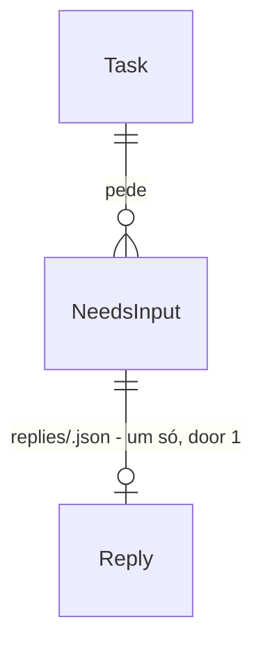

# needs-input-reply

**Approved**: 2026-11-05

## Problem

Quando o agente de uma tarefa pede uma permissão, ninguém consegue responder a tempo. O `emit` entrega o
`needs_input` e devolve `{}` na hora (`emit.py:146`); a CLI nega a ferramenta e o agente segue sem ela. O bot recebe
o aviso enquanto a tarefa roda, mas o único caminho que tem é esperar o terminal (`completed`/`denied`,
`terminal.py:137`) e retomar a sessão com `resume_hint`, o que pede uma segunda tarefa, refaz contexto e custa tempo
e tokens. Quem paga é o usuário do bot: um `touch` ou um `npm install` negado vira uma tarefa inteira refeita.

O caminho do opencode 2.x está pior que o do aviso: o plugin global que o kit instala
(`assets/opencode/grokbot-kit.ts`, só com o export nomeado `GrokbotKit`) não carrega no opencode 2.2.4 ("Plugin must
export a default definition with an id and an effect or setup function", spike 2, `spike.md`). Hoje uma tarefa do
opencode 2.x não manda `needs_input` nenhum, e o `doctor` não percebe, porque só confere o arquivo e o executável.

O issue #41 não traz números de uso; a evidência é o comportamento acima e os spikes.

O box pode estar num opencode 1.x (1.19.3 em 22/10, AD-042), e o kit não tem como atualizar uma CLI já instalada: o
`setup cli add` instala, mas nada diz ao bot que a versão ficou para trás nem reescreve o plugin quando o major muda.

Quando isto sai: num `needs_input` de permissão do Claude ou do opencode 2.x, a CLI espera até 10 minutos. O bot
avalia o risco do pedido: se é de baixo risco pela regra da skill, responde sozinho com `grokbot-kit reply <task_id>
<request_id> allow --by bot` e conta ao usuário; senão, pergunta ao usuário e responde com o que ele disser. Com
`allow` o agente usa a ferramenta na mesma tarefa, e a tarefa termina `ok` em vez de `denied`; sem resposta no prazo,
nega como hoje. `grokbot-kit setup cli upgrade opencode` leva o box ao opencode mais novo e o plugin acompanha a
versão sozinho.

## Flow

Reusa o hook `PermissionRequest` que o kit já põe no `claude-settings.json` (`launch.claude_settings`), o `emit` e a
entrega com dedupe (`deliver.deliver`), o `cli_major` que o harness já usa para o opencode 2 e o `parse_duration` do
`--timeout`.

1. `run.py` (exists) grava `ask_wait_seconds` no `meta.json` (door 4) e, no Claude, põe no hook do
   `claude-settings.json` um `timeout` acima da espera; no opencode 2.x, lança toda tarefa com `--standalone` (door 9)
2. a CLI pede uma permissão -> o hook do Claude, ou o plugin v2 do opencode pelo `permission.hook("evaluate")` (door 5,
   com `GROKBOT_KIT_REPLY=1` no env do `emit`, door 8), chama `grokbot-kit emit --from <cli>` (exists) e espera a
   saída dele
3. `emit.py` (exists) entrega o `needs_input` com `request_id` e `reply_deadline` (door 2) e espera o arquivo
   `<task_dir>/replies/<request_id>.json` (door 1) até o prazo; no prazo, cria ele mesmo o arquivo com `deny`
4. o bot aplica a regra de risco da skill (`SKILL.md`, exists): baixo risco, responde sozinho; senão, pergunta ao
   usuário; e roda `grokbot-kit reply ... --by bot|user` (door 3), que cria o arquivo da door 1 se ninguém criou antes
5. `emit.py` lê a decisão e responde à CLI no formato dela (door 6); a CLI usa ou nega a ferramenta
6. out: `run.py`/`terminal.py` (exists) classificam o terminal pelos arquivos de `replies/`: `denied` só quando algum
   pedido ficou sem `allow`

Versão do opencode, fora do caminho de uma tarefa:

7. `grokbot-kit setup cli upgrade <tool>` (door 7) roda o instalador oficial de `setup.py` (exists) e, no opencode,
   reescreve o plugin com o asset do major novo (`opencode_plugin.py`, exists; door 5)
8. antes de lançar o opencode, `run.py` (exists) compara o marcador do plugin instalado com o `cli_major` e reescreve o
   plugin se não casam; `doctor.py` (exists) acusa asset errado e avisa do opencode 1.x com o comando da door 7

## Impact

| Front | What changes |
| --- | --- |
| domain | novo termo: `request_id` - o id de um pedido do agente que o bot pode responder; é o discriminador que o `emit` já calcula (`tool_use_id`/id do pedido, ou hash de ferramenta + entrada); vive em `emit.py` e no evento |
| domain | `needs_input` deixa de ser só aviso: com espera ligada, a CLI fica parada até a resposta ou o prazo. Quem depende disso hoje: a skill do bot (seção "Quando um evento chega"), que hoje só oferece `resume_hint` |
| domain | `denied` muda de sentido: hoje é "houve `needs_input`" (AC 44 da agent-run-notify); passa a ser "algum pedido ficou sem `allow`". Quem depende disso: `terminal.classify` e a skill |
| plugin do opencode | o asset passa a ser escolhido pela versão do opencode no `install`, no `update apply`, no `setup cli upgrade` e no `run`; o arquivo instalado no box muda na primeira tarefa do opencode depois do update do kit |
| skill | o bot passa a decidir pedidos de baixo risco sozinho; quem tem a skill velha segue só avisando até o `update apply` baixar a nova (AD-036) |
| CLIs instaladas | `setup cli upgrade` troca o binário da CLI no lugar; tarefas em curso continuam com o processo já aberto |
| CLI do Claude | o hook do `claude-settings.json` ganha `timeout`; as tarefas já gravadas não mudam |
| CLI do opencode | toda tarefa do opencode 2.x roda com `--standalone` (door 9): um servidor próprio por tarefa, como as de plugin já rodavam; o `run` passa a chamar `opencode --version` antes de lançar |
| stored data | `meta.json` ganha `ask_wait_seconds`; task dirs antigos sem o campo são lidos como espera `0` (só aviso). `replies/` é novo e só existe em tarefa nova. Nada migra |

## Relations

One-way constraints: um `Reply` por `request_id`, criado por quem chegar primeiro (`reply` ou o prazo do `emit`),
nunca sobrescrito (door 1). No columns and no types here.

## Surface

O corpo que a routine recebe muda (aditivo, AD-006); a rota e os status da entrega são os da door 3 da
agent-run-notify:

| Route | In | Out | Status |
| --- | --- | --- | --- |
| `POST <webhook da routine>` (sink `grokbot-routine`, existe) | corpo `grokbot-kit.event/v1`; no `needs_input`, os campos novos `needs_input.request_id` e `needs_input.reply_deadline` (door 2) | (o de hoje) | `200` entregue; `401` e demais `4xx` falha sem retry; `429` e `500`-`599` retry (os de hoje) |

Comandos e config (exit codes):

| Comando | In | Out | Exit |
| --- | --- | --- | --- |
| `grokbot-kit reply <task_id> <request_id> allow` ou `deny [--message <text>]` `[--by bot\|user]` (door 3) | task id, request id, decisão; mensagem só com `deny`; `--by` padrão `user` | stdout `recorded <decision> for <request_id> (by <by>)`; erro em stderr | `0` gravada; `1` tarefa ou pedido desconhecido, já respondido, prazo vencido ou tarefa terminada; `2` uso inválido |
| `grokbot-kit setup cli upgrade <tool>` (door 7) | `claude`, `opencode` ou `codex`, já instalada pelo kit | stdout `<tool> <old> -> <new>` ou `<tool> <version> is already the latest`; no opencode, a linha do plugin reescrito | `0` atualizada ou já na última; `1` instalador ou `--version` falhou, ou o plugin não foi reescrito; `2` CLI fora do config |
| `grokbot-kit run ... --ask-wait <dur>` (door 4) | duração (`30s`, `10m`, `0`) | (o de hoje) | os de hoje; `2` com duração inválida |
| config `[ask] wait` (door 4) | duração, padrão `10m`, `0` desliga | - | `config.load()` recusa valor inválido como os outros campos (comandos que leem o config saem com `1`) |
| `grokbot-kit install opencode` | (existe) | grava o asset do major do opencode (door 5) | `0`, `1` (os de hoje) |
| `grokbot-kit doctor [--json]` | (existe) | problema novo: asset do plugin fora do major; aviso novo: opencode 1.x | `0`, `1` (os de hoje; o aviso não muda o exit, como na AD-040) |

## Landing

| One-way door | Literal shape | Alternative rejected |
| --- | --- | --- |
| 1. arquivo de resposta | `<task_dir>/replies/<request_id>.json` = `{"decision": "allow"\|"deny", "message": <string\|null>, "by": "user"\|"bot"\|"timeout", "at": "<ISO 8601>"}`, criado com `O_CREAT\|O_EXCL` (mesmo padrão de `sent/`) | socket ou FIFO do `emit`: morre com o processo, não deixa registro para o terminal nem para o `reply` saber que o prazo venceu |
| 2. campos do evento | `needs_input: {"kind", "tool_name", "detail", "request_id", "reply_deadline"}` | campos no topo do evento: o `needs_input` já agrupa o pedido, e `null` em todo outro evento seria ruído para a routine |
| 3. comando | `grokbot-kit reply <task_id> <request_id> allow\|deny [--message <text>] [--by bot\|user]` | `grokbot-kit answer` com JSON na entrada: a skill só roda comandos (door 8 da agent-run-notify), e argumentos posicionais são mais difíceis de errar no chat |
| 4. config e meta | `[ask]` `wait = "10m"`; `run --ask-wait <dur>`; `meta.json` `ask_wait_seconds` (inteiro, `0` = só aviso) | ler o config no `emit` a cada pedido: o `run --ask-wait` não chegaria ao `emit`, e mudar o config no meio da tarefa mudaria o prazo |
| 5. plugin do opencode 2.x | asset novo `assets/opencode/grokbot-kit.v2.ts` com `export default { id: "grokbot-kit", setup }` e `ctx.permission.hook("evaluate", ...)`; o asset atual fica para o opencode 1.x; cada asset tem na primeira linha o marcador `// grokbot-kit opencode plugin for opencode <major>` (`1` ou `2`); `install` escolhe por `cli_major` (`>= 2` ou desconhecido -> v2) | um arquivo com os dois formatos: com o `export default`, o opencode 2.2.4 ignora o export nomeado (spike 2), e o loader do 1.x diante de um default que não é função não foi testado |
| 7. upgrade de CLI | `grokbot-kit setup cli upgrade <tool>`: o mesmo instalador oficial do `setup cli add` (`setup.installer`), a versão lida por `<bin> --version` antes e depois | o `update apply` atualizar as CLIs junto com o kit: mistura o release do kit com o das CLIs, e o bot pergunta do update do kit antes de toda tarefa (AD-036); o comando próprio da CLI (`opencode upgrade`, `claude update`): cada CLI tem o seu, e o `codex` não tem um equivalente provado |
| 6. resposta do `emit` à CLI | Claude: `{"hookSpecificOutput":{"hookEventName":"PermissionRequest","decision":{"behavior":"allow"}}}` ou `"behavior":"deny","message":...`; opencode: `{"effect":"allow"\|"deny","message":<string\|null>}`; sem decisão, `{}` como hoje | exit `2` do hook: o Claude não honra exit `2` no `PermissionRequest` (research.md) |

| 8. quem pode esperar (achada no build) | o `emit` só espera com `--from claude`, ou com `--from opencode` e `GROKBOT_KIT_REPLY=1` no env, que só o plugin v2 passa; o `--from codex` e o plugin v1 do opencode 1.x seguem só avisando | esperar em todo `--from opencode`: o plugin v1 chama o `emit` com `spawnSync` e timeout de 30 s, então travaria o opencode 1.x 30 s por pedido e mataria o `emit` antes do prazo; um campo novo no stdin do plugin: mudaria o JSON da door 14 da agent-run-notify, que o plugin v1 já instalado nos boxes não manda |

| 9. opencode 2.x sempre isolado (achada no build) | `opencode run --standalone ...` em toda tarefa do opencode com major `>= 2`, não só nas de plugin (`launch.plugin_harness` já fazia isso nelas) | o serviço compartilhado do opencode 2.x (`opencode serve --service`): ele roda com o env de quem o subiu, então o plugin não vê o `GROKBOT_KIT_TASK_ID` da tarefa e fica inerte; e num `HOME` sem o serviço o `run` tenta subir outro na mesma porta e falha (C38 no host de dev, 05/11) |

- Nothing else in this change is hard to reverse: o `timeout` do hook do Claude, o intervalo de leitura do arquivo e o
  texto da regra de risco na skill são decididos no build.

## Criteria

### S1: o Claude espera a resposta do bot (P1)

Um `needs_input` de permissão do Claude segura a ferramenta até o `reply` ou o prazo.

**Acceptance Criteria**

1. WHEN o `run` lança o Claude com espera maior que `0` THEN o `claude-settings.json` SHALL ter o hook `PermissionRequest` com `timeout` igual à espera em segundos mais `60`
2. WHEN o hook `PermissionRequest` do Claude dispara numa tarefa sem plugin com espera maior que `0` THEN o `emit` SHALL entregar o `needs_input` com `needs_input.request_id` igual ao discriminador e `needs_input.reply_deadline` igual ao menor entre o pedido mais a espera e `started_at` mais `timeout_seconds`, em ISO 8601 UTC
3. WHEN `replies/<request_id>.json` aparece com `decision` `allow` antes do prazo THEN o `emit` SHALL escrever em stdout o JSON de `allow` da door 6 e sair com `0`
4. WHEN `replies/<request_id>.json` aparece com `decision` `deny` THEN o `emit` SHALL escrever o JSON de `deny` da door 6 com `message` igual à do arquivo, ou `denied by the user` quando ela é `null`
5. IF o prazo vence sem resposta THEN o `emit` SHALL criar `replies/<request_id>.json` com `decision` `deny` e `by` `timeout`, escrever o JSON de `deny` com `message` `no reply before <reply_deadline>` e sair com `0`
6. WHILE a espera da tarefa é `0` o `emit` SHALL se comportar como hoje: entregar o `needs_input` com `reply_deadline` `null`, escrever `{}` e sair na hora
7. IF a entrega do `needs_input` falha em todos os sinks THEN o `emit` SHALL esperar mesmo assim, porque o `redeliver` ainda pode entregar dentro do prazo
8. WHEN o mesmo `request_id` chega de novo e `replies/<request_id>.json` já existe THEN o `emit` SHALL responder com a decisão gravada, sem entregar outro `needs_input` e sem esperar

**Independent test:** `claude -p` real com o hook do kit, um `touch` que pede aprovação, e `grokbot-kit reply ...
allow` rodado do outro terminal: o arquivo existe e o terminal sai `ok`.

### S2: o bot responde com `grokbot-kit reply` (P1)

**Acceptance Criteria**

9. WHEN `grokbot-kit reply <task_id> <request_id> allow` roda para um pedido entregue, sem resposta e antes do prazo THEN o kit SHALL criar `replies/<request_id>.json` com `decision` `allow` e `by` `user`, imprimir `recorded allow for <request_id> (by user)` e sair com `0`
10. WHEN `reply ... deny --message <text>` roda THEN o arquivo SHALL ter `decision` `deny` e `message` igual a `<text>`
11. IF `--message` vem com `allow` THEN o `reply` SHALL sair com `2` sem gravar nada
12. IF o task dir não existe, ou nenhum `needs_input` entregue em `events.jsonl` tem esse `request_id` THEN o `reply` SHALL sair com `1` e dizer em stderr qual dos dois faltou
13. IF `replies/<request_id>.json` já existe THEN o `reply` SHALL sair com `1`, sem sobrescrever, dizendo `already answered` com a decisão gravada, ou `no reply before <reply_deadline>; the request was denied` quando `by` é `timeout`
14. IF o `meta.json` da tarefa tem `finished_at` preenchido THEN o `reply` SHALL sair com `1` com `task already finished`
15. IF o `request_id` tem caractere fora de `A-Za-z0-9._:-` THEN o `reply` SHALL sair com `2` sem tocar o disco
16. IF o `reply` e o prazo do `emit` disputam o mesmo pedido THEN o kit SHALL gravar uma única decisão, a do primeiro `O_EXCL`, e o perdedor SHALL seguir a gravada
17. WHEN `reply ... --by bot` roda THEN o arquivo SHALL ter `by` `bot`, a saída SHALL terminar em `(by bot)` e o `kit.log` SHALL ganhar a linha `reply: <decision> for <request_id> by bot`
18. IF `--by` vem com valor diferente de `bot` ou `user` THEN o `reply` SHALL sair com `2` sem gravar nada

**Independent test:** task dir de teste com `events.jsonl` de um `needs_input`; cada linha acima é um `reply` com o
exit esperado.

### S3: o opencode 2.x espera a resposta pelo plugin (P1)

**Acceptance Criteria**

19. WHEN `grokbot-kit install opencode` roda com `opencode --version` de major `2` ou maior, ou sem opencode encontrado THEN o kit SHALL gravar o asset v2 (door 5), com o caminho do executável no lugar do marcador
20. WHEN `install opencode` roda com `opencode --version` de major `1` THEN o kit SHALL gravar o asset atual, sem mudança de comportamento
21. WHEN o opencode 2.x avalia uma permissão com `effect` `ask` numa sessão sem `parentID`, dentro de uma tarefa THEN o plugin SHALL chamar `grokbot-kit emit --from opencode` sem bloquear o processo do opencode, com o pedido `{type: "permission.asked", properties, parentID}` em que `properties.permission` é a `action`, `properties.patterns` os `resources` e `properties.id` o `source.id`, e esperar a saída por até `ask_wait_seconds + 60` segundos
22. WHEN o `emit` responde `{"effect": "allow"}` ou `{"effect": "deny", "message": ...}` THEN o plugin SHALL pôr esse `effect` e essa `message` no evento do `evaluate`; com `{}`, saída inválida ou timeout, SHALL deixar o `effect` como veio (o `opencode run` nega)
23. WHILE `GROKBOT_KIT_TASK_ID` não está no ambiente o plugin v2 SHALL não registrar hook nenhum nem chamar o `grokbot-kit`
24. WHEN o `doctor` confere o plugin do opencode THEN ele SHALL acusar, com `grokbot-kit install opencode`, o asset que não casa com o major do opencode instalado (v1 num opencode 2.x ou o contrário)
25. WHEN o `run` vai lançar o opencode, o plugin está instalado e o marcador dele não casa com o `cli_major` THEN o kit SHALL reescrever o plugin com o asset do major antes de lançar e gravar no `kit.log` `opencode plugin rewritten for opencode <major>`
26. IF a reescrita da AC 25 falha THEN o kit SHALL gravar o motivo no `kit.log` e lançar a tarefa mesmo assim

**Independent test:** `opencode run --standalone` com `HOME` temporário, plugin instalado pelo `install`,
`"permission": {"bash": "ask"}` e um `touch`; `reply ... allow` cria o arquivo.

### S4: o terminal reflete a resposta (P1)

**Acceptance Criteria**

27. WHEN todos os `needs_input` de uma tarefa têm `replies/<request_id>.json` com `allow` e a saída do Claude não traz `permission_denials` THEN o kit SHALL classificar o terminal como numa tarefa sem pedido (`ok`/`success` quando o resto está bem)
28. IF algum `needs_input` não tem resposta, tem `deny` ou tem `by` `timeout` THEN o kit SHALL classificar como hoje, `completed`/`denied`/`permission_denied`
29. WHILE a tarefa é de plugin o `emit` SHALL não entregar `needs_input` nem esperar, como hoje (AC 44 da plugins)

**Independent test:** `terminal.classify` e o `run` com um fake de CLI que pede, recebe `allow` e sai `0`.

### S5: o kit atualiza as CLIs e o plugin acompanha (P1)

O box sai do opencode 1.x com um comando, e o plugin segue a versão sem passo manual.

**Acceptance Criteria**

30. WHEN `grokbot-kit setup cli upgrade <tool>` roda para uma CLI com `[cli.<tool>] bin` no config THEN o kit SHALL rodar o instalador oficial do `setup cli add`, ler `<bin> --version` antes e depois e imprimir `<tool> <old> -> <new>`, ou `<tool> <version> is already the latest` quando são iguais, e sair com `0`
31. IF a CLI não está no config THEN o `setup cli upgrade` SHALL sair com `2` com `<tool> is not installed by grokbot-kit; run: grokbot-kit setup cli add <tool>`
32. IF o instalador sai com código diferente de `0` ou o `--version` de depois falha THEN o `setup cli upgrade` SHALL sair com `1` com o motivo, sem mudar o config
33. WHEN `setup cli upgrade opencode` termina a instalação e o plugin do opencode está instalado THEN o kit SHALL reescrever o plugin com o asset do major novo e imprimir `opencode plugin rewritten for opencode <major>`; se a reescrita falha, SHALL sair com `1` com `run: grokbot-kit install opencode`
34. WHEN o `doctor` acha o opencode com major `1` THEN ele SHALL mostrar o aviso `opencode <version>: replies to needs_input need opencode 2; run: grokbot-kit setup cli upgrade opencode`, sem entrar em `problems` nem mudar o exit code

**Independent test:** `setup cli upgrade opencode` com `HOME` temporário e o instalador trocado por um fake que troca o binário de `1.19.3` para `2.2.4`: a saída mostra as duas versões e o plugin passa a ter o marcador `2`.

### S6: o bot sabe responder, e a doc diz como (P1)

**Acceptance Criteria**

35. The `skills/grokbot-kit/SKILL.md` SHALL dizer, para um `needs_input` de `permission` com `reply_deadline` não nulo, que o bot avalie o risco do pedido pela regra da skill antes do `reply_deadline`; e, com `reply_deadline` `null`, que siga o caminho de hoje (`resume_hint`)
36. The regra de risco do `SKILL.md` SHALL listar como baixo risco só: ler, listar ou buscar arquivos; rodar testes, linters, checagem de tipos ou o build do projeto; criar ou editar arquivos dentro do `cwd` do evento; e comandos `git` só de leitura (`status`, `diff`, `log`, `show`)
37. The regra de risco do `SKILL.md` SHALL mandar perguntar ao usuário todo pedido fora da lista da AC 36, citando: caminho fora do `cwd`; rede (download, instalação de pacote, `git fetch`/`pull`/`push`/`clone`); apagar arquivos; reescrever histórico do `git`; segredos, credenciais, `.env` ou `~/.ssh`; `sudo` e mudanças no sistema; e todo pedido que o bot não consegue classificar
38. The `SKILL.md` SHALL mandar o bot responder sozinho com `grokbot-kit reply <task_id> <request_id> allow --by bot` e contar ao usuário, em uma linha, o que aprovou; e, nos outros casos, mostrar `tool_name` e `detail`, perguntar e rodar `reply` com `--by user`
39. The `SKILL.md` SHALL dizer que o bot nunca nega sozinho: sem resposta do usuário até o `reply_deadline`, o kit nega
40. The `SKILL.md` SHALL mandar o bot oferecer `grokbot-kit setup cli upgrade opencode` ao usuário quando o `doctor` mostrar o aviso de opencode 1.x
41. The `README.md` e o `docs/pt-BR/README.md` SHALL listar `reply` (com `--by`), `run --ask-wait` e `setup cli upgrade` em `## Commands`, e o `docs/event.md` e o `docs/pt-BR/event.md` SHALL descrever `needs_input.request_id` e `needs_input.reply_deadline`
42. The `README.md` e o `docs/pt-BR/README.md` SHALL dizer que a resposta a pedidos vale no Claude e no opencode 2.x, que o opencode 1.x só avisa, e que `grokbot-kit setup cli upgrade opencode` atualiza o opencode e o plugin
43. The `CHANGELOG.md` SHALL ter em `## [Unreleased]` o `reply`, o `--ask-wait`, o `[ask] wait`, os campos novos, a mudança de `denied`, a regra de risco da skill, o `setup cli upgrade` e a correção do plugin do opencode 2.x

**Independent test:** `tests/test_docs.py` e `tests/test_skill_doc.py` verdes.

## Out of scope

| Excluded | Why |
| --- | --- |
| responder pedidos do Codex | o `codex exec` nunca chama o hook (AD-027); o caminho é o `codex app-server`, feature própria |
| responder `question` do opencode | o `opencode run` cria a sessão com `question: deny` (AD-026); não há pergunta para responder |
| responder no opencode 1.x | o `permission.ask` do 1.x não foi provado; o 1.x segue só com aviso, e o caminho é o `setup cli upgrade opencode` |
| atualizar as CLIs sozinho (sem comando), ou fixar versão | o upgrade é uma ação explícita do bot ou do usuário; fixar versão pede suporte a versão nos três instaladores |
| "permitir sempre" (regra persistente a partir da resposta) | muda a permissão da tarefa além do pedido; a resposta vale para um `request_id` |
| pedidos de sessões filhas do opencode | o `emit` já as descarta (AC 55 da agent-run-notify); seguem negadas |
| aviso ao bot do resultado da resposta (evento novo) | o terminal já diz `ok` ou `denied`; um evento por resposta seria mudança de contrato sem pedido |

## Assumptions

| Assumption | Chosen default | Rationale | Confirmed? |
| --- | --- | --- | --- |
| espera padrão, ligado por padrão, prazo vencido nega, plugin não pergunta | `10m`, ligado em Claude e opencode 2.x, `deny`, plugin sem espera | decisões do Rodrigo em 05/11/2026 (research.md) | y |
| `timeout` acima de 600 s no hook do Claude | aceito: espera + 60 s | spike 1: o `claude` 2.1.318 esperou um hook de 660 s com `timeout: 900` (spike.md) | y |
| pedido repetido idêntico | responde com a decisão gravada (AC 8). No Claude o `request_id` é o hash de ferramenta + entrada, então repetir o mesmo comando reaproveita; no opencode o id é do tool call, então cada chamada pergunta de novo | segue a AD-017 (um `needs_input` por permissão distinta) sem regra nova | n |
| versão do opencode no box | o box estava no 1.19.3 em 22/10 (AD-042); o Rodrigo leva o box ao 2.x com `setup cli upgrade opencode` (S5) depois do release; até lá, só aviso | não há como conferir daqui; o `doctor` avisa (AC 34) | y |
| o bot decide pedidos de baixo risco sozinho | sim, pela lista fechada da AC 36; o resto vai ao usuário (AC 37) | pedido do Rodrigo em 05/11/2026, para dar autonomia ao bot | y |
| quem decidiu fica registrado | `reply --by bot\|user`, no arquivo de resposta e no `kit.log` (AC 17) | decisão do Rodrigo em 05/11/2026 | y |
| o bot nega sozinho? | não: só aprova sozinho; o que não aprova vai ao usuário, e o prazo nega (AC 39) | negar algo que o usuário aprovaria custa a tarefa; o prazo já é o `deny` padrão | n |
| atualizar a CLI pelo kit | dentro desta feature, com `setup cli upgrade <tool>` (door 7) | decisão do Rodrigo em 05/11/2026 | y |
| o instalador oficial atualiza uma CLI já instalada | rodar o mesmo instalador do `setup cli add` troca o binário pela última versão | é o que os instaladores de `claude`, `opencode` e `codex` fazem por padrão; o build confere com o opencode num `HOME` temporário antes dos testes | n |
| prazo da espera contra o timeout da tarefa | `reply_deadline` é o menor dos dois (AC 2); o supervisor do `run` mata a CLI no timeout como hoje | o bot não deve receber um prazo que a tarefa não cumpre | n |
| o `emit` lê o arquivo por polling | intervalo decidido no build (até 1 s) | stdlib só (AD-009); inotify pede dependência ou `ctypes` | n |

**Open questions:** none - all resolved or logged above.

## Observable

| Surface | Decision | Landing |
| --- | --- | --- |
| command `reply` | output format | AC 9, 13, 14, 17 |
| command `reply` | flags and defaults | AC 10, 11, 17, 18 (`--message` só com `deny`, sem padrão; `--by` padrão `user`) |
| command `reply` | exit codes | AC 9, 11-15, 18 |
| command `reply` | failure halfway | AC 16 - a gravação é um `O_EXCL`; não há estado parcial |
| command `run --ask-wait` | flag and default | AC 1, 6; padrão do `[ask] wait` (door 4) |
| command `run --ask-wait` | invalid value | Surface: `2`, mesma mensagem do `parse_duration` do `--timeout` |
| command `install opencode` | which asset | AC 19, 20 |
| command `doctor` | asset fora da versão, opencode 1.x | AC 24, 34 |
| command `setup cli upgrade` | output format | AC 30, 33 |
| command `setup cli upgrade` | flags and defaults | n/a - só o argumento `<tool>`, sem flags |
| command `setup cli upgrade` | exit codes | AC 30-33 |
| command `setup cli upgrade` | failure halfway | AC 32 (config intocado), AC 33 (CLI nova e plugin velho: sai `1` com o comando que conserta; o `run` reescreve na próxima tarefa, AC 25) |
| command `run` | plugin fora da versão | AC 25, 26 |
| event `needs_input` | response shape | AC 2, 6 (door 2) |
| event `needs_input` | versioning | aditivo em `0.x` (AD-006); routines que ignoram campos não quebram |
| event `needs_input` | error shape, rate limits | n/a - o evento não tem resposta da routine além do recibo de hoje |
| document `SKILL.md` | what the reader does next | AC 35-40 |
| document README / event.md | structure, both languages | AC 41, 42; regra de par do AGENTS.md |

## Sources

- issue #41 e `docs/.specs/features/needs-input-reply/research.md` - pedido, pesquisa e decisões do Rodrigo
- `docs/.specs/features/needs-input-reply/spike.md` - espera do hook do Claude e `permission.hook("evaluate")` do
  opencode 2.x provados
- decisões do Rodrigo no chat de 05/11/2026 - o bot decide pedidos de baixo risco, `--by`, upgrade de CLI nesta
  feature
