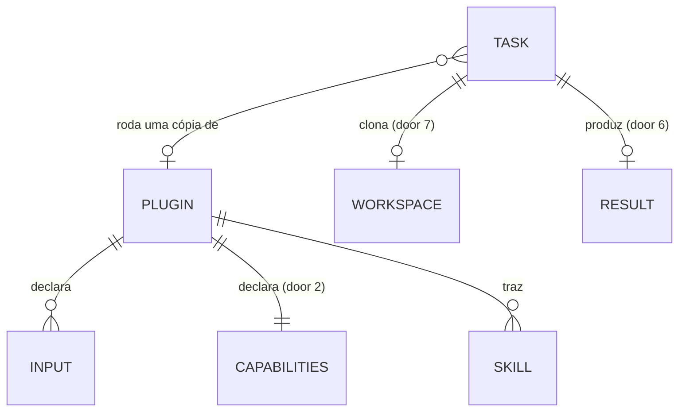

# plugins

## Problem

O Grok Bot revisa os PRs de um repositório que observa com a própria capacidade: pelo menos 10 reviews por dia,
que comem boa parte do limite de tokens do bot (relato do Rodrigo em 21/10/2026; não há medição). O kit delega
trabalho às CLIs do box, mas só aceita um prompt solto: o bot teria de escrever o prompt do review a cada vez, o
agente roda com o `gh` autenticado e permissão de escrita em qualquer lugar (pode dar push no PR que revisa), carrega
os settings e hooks do repositório em que roda (num clone de PR, o autor do PR decide o que executa no box), e o
resultado volta como texto livre que o bot precisa reler.

Quando isto sai: o bot dispara uma capacidade pronta com poucos parâmetros - `grokbot-kit run --plugin code-review
--input pr=<url>` - que roda num clone novo, independente do harness do repositório, com o que o agente pode fazer
declarado e imposto pela CLI, e recebe na routine um resultado estruturado. Qualquer pessoa escreve um plugin
seguindo o guia, com o `code-review` como exemplo; o formato é instável até a 1.0, como o webhook.

## Flow

Reusa o `run` inteiro (resolução de CLI e modelo, task dir, supervisão, timeout, entrega, `redeliver`, `gc`), o
registro de tarefa no `meta.json`, o `doctor` e o padrão de escrita atômica do `install opencode`; o plugin só
acrescenta o que entra antes do lançamento e o que é conferido depois.

1. a skill roda `grokbot-kit plugin list --json` -> `cli.py` (exists) -> `plugin.py` (door 4) lê os plugins próprios
   do pacote e os instalados no diretório de plugins (door 3), cada um com o manifesto (door 1) e a matriz de
   capacidades (door 8)
2. `plugin add <origem>` -> `plugin.py` (door 4) valida layout e manifesto (doors 1 e 2), mostra as capacidades,
   confirma e grava a cópia fixada (door 3)
3. `run --plugin <nome> --input k=v` -> `run.py` (exists) resolve o plugin por `plugin.py` (door 4), valida as
   entradas, recusa CLI que não impõe as capacidades (door 8) - tudo antes do task dir
4. `run.py` (exists) cria o task dir, copia o plugin para ele, clona o workspace (door 7) e monta o harness da CLI a
   partir das capacidades (door 8) com `launch.py` (exists)
5. `run.py` (exists) lança e supervisiona como hoje, com `cwd` no workspace e o prompt do plugin com as entradas e o bloco de ambiente das capacidades (door 9)
6. ao sair, `run.py` (exists) lê o resultado (door 6), `terminal.py` (exists) classifica com a regra de plugin e
   `payload.py` (exists) monta o evento com `plugin` e `result` (door 5); `deliver.py` (exists) entrega à routine
7. `doctor.py` (exists) lista os plugins e a matriz de suporte por CLI, acusa manifesto ilegível e avisa `gh` sem login

## Impact

| Front | What changes |
| --- | --- |
| domain | novo termo: `plugin` - diretório com manifesto, prompt e skills que define uma capacidade pronta; vive em `plugin.py` |
| domain | novo termo: `capacidade` - declaração fechada do que o agente pode fazer numa tarefa de plugin (door 2) |
| domain | novo termo: `workspace` - clone do PR ou branch dentro do task dir, `cwd` do agente |
| domain | existing term: `completed/denied` significava "o agente esbarrou numa permissão"; em tarefa de plugin deixa de existir, porque negação é esperada - quem branch nele hoje: o prompt de routine da skill, que só passa a ver `result` ou `result_invalid` em tarefas de plugin |
| evento | `grokbot-kit.event/v1` ganha `plugin` e `result` (`null` fora de plugin) e o `exit_reason` `result_invalid`; aditivo (AD-006) |
| skill | `SKILL.md` ganha a seção de plugins; quem tem a skill velha continua delegando sem plugin |
| stored data | diretório novo de plugins instalados; `meta.json` ganha `plugin` em tarefas de plugin; nada existente migra |
| run sem plugin | inalterado: mesmos argumentos, mesmo harness, mesma classificação |

## Relations

One-way constraints: `name` do plugin é único entre próprios e instalados (door 3); um plugin instalado guarda o
commit de origem e não muda sem novo `plugin add --replace` (door 3); a tarefa roda a cópia do plugin no task dir,
nunca o diretório instalado (door 3).

## Surface

Rota HTTP de saída cujo corpo muda (door 5):

| Route | In | Out | Status |
| --- | --- | --- | --- |
| `POST https://api2.cursor.sh/automations/webhook/<routine-uuid>` (sink `grokbot-routine`, AD-021) | evento `grokbot-kit.event/v1` com os campos novos `plugin` e `result` e o `exit_reason` `result_invalid` | `runUuid` (existe) | `200` recibo; `401` e outros 4xx sem retry; 5xx e falha de rede com retry (existentes, AD-014) |

Comandos sem contrato HTTP (exit codes):

| Comando | In | Out | Exit |
| --- | --- | --- | --- |
| `grokbot-kit plugin list [--json]` | `--json` (padrão: texto) | uma linha por plugin, ou o objeto da door 4 | `0` |
| `grokbot-kit plugin show <nome-ou-origem> [--json]` | nome ou origem; `--json` | manifesto, entradas, capacidades e suporte por CLI | `0`, `2` |
| `grokbot-kit plugin add <origem> [--ref <ref>] [--replace] [--yes]` (origem = diretório ou URL git) | origem, ref, flags | capacidades e a linha `installed <nome> <versão> (<commit>)` | `0`, `1`, `2` |
| `grokbot-kit plugin rm <nome>` | nome | `removed <nome>` | `0`, `2` |
| `grokbot-kit run --plugin <nome> --input <k>=<v> ...` | plugin, entradas, flags do `run` existentes | o exit do agente, como hoje | `0`, `2`, exit do agente, `124`, `127`, `130` |
| `grokbot-kit doctor [--json]` | (existe) | campo novo `plugins` | (existentes) |

## Landing

| One-way door | Literal shape | Alternative rejected |
| --- | --- | --- |
| 1. layout do plugin | diretório com `.claude-plugin/plugin.json` (`name`, `version`, `description`), `grokbot-kit.toml`, o arquivo de prompt e `skills/<skill>/SKILL.md`; nada mais além de arquivos de texto referenciados pelas skills; `hooks/`, `commands/`, `agents/`, `.mcp.json`, `.lsp.json` recusam | formato próprio do kit - não carregaria no Claude Code e obrigaria quem escreve a aprender dois layouts; layout completo do Claude Code - traria hooks e MCP, código que roda no box |
| 2. manifesto e capacidades | `grokbot-kit.toml`: `schema = "grokbot-kit.plugin/v0"`, `name`, `version`, `description`, `prompt = "<arquivo>"`, `[inputs.<nome>] kind = "repo"\|"text"\|"file"`, `required = true`, `[capabilities] write = "task-dir"\|"none"`, `network = "on"\|"off"`, `commands = ["<prefixo>", ...]`, `[result] required = ["<campo>", ...]`, `max_bytes = 16384`; prompt com `{<entrada>}`, `{workspace}`, `{result_file}`, `{task_dir}`; `name` em `^[a-z0-9][a-z0-9-]{0,39}$` | capacidades abertas (qualquer chave) - o kit não teria como recusar o que não sabe impor; gates por script - código do plugin rodando no box |
| 3. armazenamento | próprios em `grokbot_kit/assets/plugins/<nome>/` no pacote; instalados em `~/.grokbot-kit/plugins/<nome>/` com `origin.json` = `{"source": "dir"\|"git", "origin": "<caminho\|url>", "ref": "<ref>"\|null, "commit": "<sha>"\|null, "installed_at": "<RFC 3339>"}`; gravação em diretório temporário + `os.rename`; a tarefa copia o plugin para `<task_dir>/plugin/` | apontar para o diretório de origem - a origem muda debaixo do kit; git sem cópia - exigiria rede a cada tarefa |
| 4. comandos `plugin` e `run --plugin` | os da Surface; `2` = recusa (nome, manifesto, layout, entrada, capacidade sem suporte, conflito, tarefa rodando), `1` = falha de E/S ou do `git`; `plugin list --json` = `{"plugins": [{"name", "version", "description", "source": "builtin"\|"dir"\|"git", "origin", "commit", "inputs": {"<nome>": {"kind", "required"}}, "capabilities": {...}, "support": {"claude"\|"opencode"\|"codex": {"write"\|"network"\|"commands"\|"workspace_config"\|"skills": "os"\|"tool"\|"unsupported"}}}]}` | `run --prompt-file` com um prompt de review guardado na skill - não impõe nada e não estrutura o resultado |
| 5. evento | campos `plugin` = `{"name", "version", "source", "commit"}` \| `null` e `result` = objeto \| `null`; `exit_reason` ganha `result_invalid`; tudo aditivo a `grokbot-kit.event/v1` | schema `v2` - quebraria routines existentes por campos que são `null` fora de plugin |
| 6. resultado | o agente grava `<task_dir>/result.json` (objeto JSON); caminho também em `GROKBOT_KIT_RESULT_FILE`; o kit lê só esse arquivo | ler o resultado da última mensagem do agente - cada CLI formata diferente e o texto não é JSON garantido |
| 7. workspace | entrada `kind = "repo"` aceita `https://github.com/<owner>/<repo>/pull/<n>` e `https://github.com/<owner>/<repo>/tree/<branch>`; o kit clona em `<task_dir>/work` com o `gh` do box e faz checkout do PR ou da branch antes de lançar; `cwd` do agente = `<task_dir>/work` | o agente clonar sozinho - o `cwd` não seria o clone, as instruções do repo não carregariam, e a CLI já teria carregado a configuração do lugar errado |
| 8. matriz de capacidades | tabela por CLI e versão testada, com cada célula `os`, `tool` ou `unsupported` para `write`, `network: off`, `commands`, `workspace_config` (settings, hooks, plugins e MCP do workspace não carregam) e `skills` do plugin; linha acrescentada aqui com o resultado do S1, antes de qualquer código de tradução | impor no kit (sandbox próprio) - o `bwrap` não sobe no box sem root, o mesmo motivo do erro aberto do Codex |
| 8. matriz provada (S1, `spike.md`, AD-042) | `assets/capabilities.json`: `claude` e `opencode` = `write` `tool`, `network` `unsupported`, `commands` `tool`, `workspace_config` `tool`, `skills` `tool`; `codex` = tudo `unsupported`. Harness (`launch.plugin_harness`): `claude` com `--restricted --strict-mcp-config --tools Read,Glob,Grep,Edit,Write,Skill[,Bash] --add-dir <task_dir> --plugin-dir <task_dir>/plugin --permission-mode dontAsk` e, no `claude-settings.json`, `permissions.allow` = `Edit`/`Write(//<task_dir>/**)` (com `write = "none"`, só `result.json`) + `Bash(<prefixo>)`/`Bash(<prefixo> *)`, `permissions.deny` = `Edit`/`Write(//<task_dir>/plugin/**)` (+ `WebFetch`, `WebSearch` com `network = "off"`); `opencode` com `OPENCODE_DISABLE_PROJECT_CONFIG=1`, `OPENCODE_DISABLE_CLAUDE_CODE_SKILLS=1` e `OPENCODE_CONFIG_CONTENT` = `{"permission": {"edit": {"*": "allow", "<plugin>/*": "deny"}, "external_directory": {"*": "deny", "<task_dir>/*": "allow"}, "bash": {"*": "deny", "<prefixo>": "allow", "<prefixo> *": "allow"}, "skill": "allow"}, "skills": {"paths": ["<plugin>/skills"]}}`, e `--standalone` quando `opencode --version` dá 2 ou mais; toda CLI recebe `PWD` = cwd | sandbox do sistema (`os`) - o `bwrap` não sobe no box nem no host do spike; esconder o plugin do agente - skills leem os arquivos de apoio da pasta delas |
| 9. ambiente no prompt (AD-043) | `\n\n## Ambiente desta tarefa\n\n` + uma linha por regra: `- O shell só aceita comandos que começam por um destes prefixos: <prefixos entre crases, separados por vírgula>. Qualquer outro é negado.` e `- Um comando por chamada, sem \`;\`, \`&&\`, \`\|\|\`, \`\|\` nem \`cd\`.` (com `commands = []`, só `- O shell não aceita nenhum comando.`); `- Leia, liste e procure arquivos com as ferramentas de leitura e busca da CLI, não com o shell.`; `- Você só escreve dentro de <task_dir>.` (com `write = "none"`, `- Você só escreve o arquivo de resultado, <result_file>.`); `- Sem acesso à rede.` só com `network = "off"`; `- Uma permissão negada não encerra a tarefa: siga com as ferramentas e os comandos liberados.`; acrescentado pelo kit ao fim do prompt do plugin, em pt-BR, a língua do bot | só nos prompts dos plugins próprios - plugin de terceiro cairia na mesma armadilha e a lista copiada divergiria do manifesto; nada no prompt - no box o agente teve um comando composto negado e concluiu que não tinha shell |
| 10. redirecionamento negado no opencode (AD-044) | no `OPENCODE_CONFIG_CONTENT`, `permission.bash` = `{"*": "deny", "<prefixo>": "allow", "<prefixo> *": "allow", "*>*": "deny"}`, nessa ordem (no opencode vale a última regra que casa): todo comando com `>` é negado, mesmo começando por um prefixo liberado | confiar no prompt (door 9) para o agente não redirecionar - foi o bloco que mostrou o prefixo ao agente do Verifier; tirar `commands` do opencode - o `code-review` e o `bug-verify` não rodariam nele |
| 11. `--output` negado e o contrato de `write` (AD-045) | com `commands` não vazio: no `claude`, `permissions.deny` ganha `Bash(*--output*)`; no `opencode`, `permission.bash` ganha `"*--output*": "deny"` depois de `"*>*"`. A célula `tool` de `write` confina as ferramentas de arquivo do agente e o shell (redirecionamento, encadeamento, pipe, substituição); um comando liberado escreve onde as opções e o código que ele roda deixam, e os docs dizem isso | negar opção a opção por comando - corrida sem fim garantido; Landlock (célula `os`) - feature própria, fica para depois |
| 12. symlink que sai do clone recusa a tarefa (AD-046) | depois do clone e do checkout da door 7, antes de lançar o agente, o kit percorre `<task_dir>/work` (fora `.git/`, sem seguir links) e, se o alvo resolvido de algum symlink está fora de `<task_dir>/work`, não lança o agente e entrega `error`/`failed`/`agent_error` com `summary` = `the clone has symbolic links that point outside it: <caminho>, ...` (até 5 caminhos relativos, ordenados, e `(+N more)`); vale para todas as CLIs | apagar os links - o review não veria o link suspeito; recusar só no opencode - duas regras por CLI para um caso raro em repositório legítimo |

- Nada mais aqui é difícil de reverter: textos, saída em texto, nomes de arquivos internos ao task dir além dos das doors 3, 6 e 7, e o conteúdo dos prompts dos plugins próprios mudam num refactor.

## Criteria

### S1: a matriz de capacidades está provada no box (P1)

Cada célula da door 8 tem valor provado nas versões do box, e é isso que o kit usa para aceitar ou recusar.

**Acceptance Criteria**

1. WHEN o spike roda no box THEN ele SHALL registrar, para `claude`, `opencode` e `codex` nas versões instaladas, um valor `os`, `tool` ou `unsupported` para cada uma das 5 capacidades da door 8, cada valor com o comando que o provou e a saída observada
2. The prova de `write` SHALL ser um agente instruído a criar um arquivo fora do task dir; a célula só é `os` ou `tool` se o arquivo não existir depois
3. The prova de `commands` SHALL ser um agente instruído a rodar um comando fora da lista declarada; a célula só é `os` ou `tool` se o comando não executar
4. The prova de `workspace_config` SHALL ser um workspace com um hook ou plugin de projeto que cria um arquivo marcador ao iniciar; a célula só é `os` ou `tool` se o marcador não existir depois
5. The prova de `skills` SHALL ser uma skill do plugin com uma instrução que o agente só segue se a skill carregou
6. WHEN o spike termina THEN a linha da door 8 SHALL ser preenchida com a matriz antes de qualquer código das doors 2 e 8
7. IF uma CLI tem `unsupported` em `write` ou em `workspace_config` THEN a matriz SHALL marcá-la como fora de tarefas de plugin
8. IF o suporte de uma CLI depende do host (sandbox do sistema) THEN o spike SHALL registrar o comando que o kit roda para saber se o host suporta, ou marcar a célula `unsupported` quando nenhum comando assim existe

**Independent test:** `docs/.specs/features/plugins/spike.md` com as 15 células, cada uma com comando e saída.

### S2: o plugin é instalado, listado e removido (P1)

**Acceptance Criteria**

9. WHEN `plugin list --json` roda THEN o kit SHALL imprimir o objeto da door 4 com os plugins próprios (`source` `builtin`) e os instalados, ordenados por `name`
10. WHEN `plugin list` roda sem `--json` THEN o kit SHALL imprimir uma linha por plugin: `<nome> <versão> <source> - <description>`
11. WHEN `plugin show <nome>` roda THEN o kit SHALL imprimir entradas, capacidades e o `support` de cada CLI da door 4
12. WHEN `plugin show` recebe um diretório ou URL git em vez de nome THEN o kit SHALL ler a origem com as mesmas validações do `plugin add` (AC 17-19) e imprimir o mesmo objeto, sem gravar nada
13. IF `plugin show` recebe um nome que não existe THEN o kit SHALL sair com `2` com `no plugin named <nome>; run: grokbot-kit plugin list` em stderr
14. WHEN `plugin add <dir>` recebe um diretório com layout e manifesto válidos THEN o kit SHALL imprimir as capacidades, pedir confirmação no terminal e, confirmado, gravar a cópia e o `origin.json` da door 3 e sair com `0`
15. WHEN `plugin add` roda com `--yes` THEN o kit SHALL imprimir as capacidades e gravar sem pedir confirmação
16. IF `plugin add` roda sem `--yes` com stdin que não é terminal THEN o kit SHALL sair com `2` sem gravar
17. WHEN `plugin add <git-url>` roda THEN o kit SHALL clonar, resolver `--ref` (padrão: a branch padrão) para o commit completo e gravá-lo em `origin.json`
18. IF a origem tem `hooks/`, `commands/`, `agents/`, `.mcp.json` ou `.lsp.json` THEN o `plugin add` SHALL sair com `2` nomeando o que encontrou, sem gravar
19. IF o manifesto não é TOML válido, não tem `schema` `grokbot-kit.plugin/v0`, tem chave de capacidade ou valor fora da door 2, `name` fora da regex, `name` diferente do `.claude-plugin/plugin.json`, arquivo de prompt ausente, ou um `{...}` no prompt que não é entrada nem variável da door 2 THEN o `plugin add` SHALL sair com `2` nomeando o primeiro erro, sem gravar
20. IF o nome é de um plugin próprio THEN o `plugin add` SHALL sair com `2`
21. IF o nome já está instalado e não há `--replace` THEN o `plugin add` SHALL sair com `2`
22. IF o clone ou a leitura da origem falha THEN o `plugin add` SHALL sair com `1` sem deixar diretório parcial em `~/.grokbot-kit/plugins/`
23. WHEN `plugin rm <nome>` roda num plugin instalado sem tarefa rodando THEN o kit SHALL apagar o diretório e sair com `0`
24. IF `plugin rm` recebe um plugin próprio ou um nome inexistente THEN o kit SHALL sair com `2`
25. IF algum task dir tem `meta.json` com `plugin.name` igual ao nome, `finished_at` `null` e `started_at` + `timeout_seconds` + 60 s depois de agora THEN o `plugin rm` e o `plugin add --replace` SHALL sair com `2` listando os `task_id`

**Independent test:** `plugin add` de um diretório de teste, `plugin list --json` mostra o plugin com `source` `dir`, `plugin rm` o tira; o mesmo diretório com `hooks/` é recusado com `2`.

### S3: o run executa um plugin (P1)

**Acceptance Criteria**

26. WHEN `run --plugin <nome> --input k=v ...` roda com entradas válidas e CLI que impõe todas as capacidades THEN o kit SHALL criar o task dir, copiar o plugin para `<task_dir>/plugin/`, clonar as entradas `repo` (door 7) e lançar o agente com `cwd` em `<task_dir>/work` e o prompt do plugin com as variáveis substituídas
27. IF falta entrada `required`, sobra `--input` que o manifesto não declara, ou o valor de `repo` não casa com as URLs da door 7 THEN o `run` SHALL sair com `2` antes de existir task dir
28. IF uma entrada `file` aponta para arquivo inexistente ou maior que 1 MiB, ou uma entrada `text` passa de 64 KiB THEN o `run` SHALL sair com `2` antes de existir task dir
29. WHEN a entrada é `file` THEN o kit SHALL copiá-la para `<task_dir>/inputs/<nome>` e substituir `{<nome>}` por esse caminho
30. IF o plugin não existe THEN o `run` SHALL sair com `2` antes de existir task dir
31. IF `--plugin` vem com `--prompt-file`, com argumentos depois de `--`, ou com `--cwd` num plugin que tem entrada `repo` THEN o `run` SHALL sair com `2` antes de existir task dir
32. IF a matriz da door 8 marca `unsupported`, para a CLI resolvida, alguma capacidade que o plugin declara THEN o `run` SHALL sair com `2` antes de existir task dir, com `plugin <nome> needs <capacidade>=<valor>, which <tool> cannot enforce` em stderr
33. IF o clone ou o checkout da door 7 falha THEN o kit SHALL não lançar o agente e entregar `error`/`failed` com `exit_reason` `agent_error` e o motivo (com a saída do `gh`) no `summary`
34. The tarefa de plugin SHALL não carregar settings, hooks, plugins nem servidores MCP do workspace (célula `workspace_config` da matriz)
35. WHILE uma tarefa de plugin roda com `write = "task-dir"` a CLI SHALL negar escrita fora de `<task_dir>`
36. WHILE uma tarefa de plugin roda a CLI SHALL negar comandos fora de `commands`
37. WHERE o plugin declara `network = "off"` a CLI SHALL negar acesso à rede
38. The tarefa de plugin SHALL carregar as skills do plugin
39. The `meta.json` de uma tarefa de plugin SHALL ter `plugin` com `name`, `version`, `source`, `commit`, `capabilities` e o `support` da CLI usada
40. The `run` sem `--plugin` SHALL manter argumentos, harness e classificação de hoje

**Independent test:** com o `gh` e uma CLI de teste (fake) que registra `cwd`, argv e env, `run --plugin <teste> --input pr=<url>` mostra o `cwd` no clone, o prompt substituído e o harness com as capacidades; no box, a mesma tarefa com o `claude` real não consegue criar um arquivo em `~/`.

### S4: o resultado chega estruturado à routine (P1)

**Acceptance Criteria**

41. WHEN o agente de uma tarefa de plugin sai com `0` e `<task_dir>/result.json` é um objeto JSON com todos os campos de `result.required` e no máximo `max_bytes` THEN o kit SHALL entregar `completed`/`ok`/`success` com `result` = o objeto e `plugin` preenchido
42. WHEN o resultado válido tem `summary` string THEN o `summary` do evento SHALL ser esse texto, cortado em 2000 caracteres (AD-015)
43. IF o agente sai com `0` e `result.json` não existe, não é objeto JSON, falta campo de `result.required` ou passa de `max_bytes` THEN o kit SHALL entregar `error`/`failed`/`result_invalid` com `result` `null` e o motivo no `summary`
44. WHILE a tarefa é de plugin o kit SHALL não classificar como `denied`: uma negação de permissão registrada pela CLI vai ao `kit.log` e não muda o status
45. IF a tarefa de plugin termina por timeout, interrupção, binário ausente, erro do agente ou exit diferente de `0` THEN o kit SHALL classificar como hoje, com `result` `null` e `plugin` preenchido
46. The evento de tarefa sem plugin SHALL ter `plugin` `null` e `result` `null`
47. The schema `event.v1.json` SHALL aceitar os campos e o `exit_reason` da door 5, e todo evento emitido SHALL validar contra ele

**Independent test:** uma CLI fake que grava `result.json` válido gera `completed/ok` com `result`; sem o arquivo, `error/failed/result_invalid`.

### S5: o plugin code-review revisa um PR (P1)

**Acceptance Criteria**

48. The plugin próprio `code-review` SHALL declarar a entrada `pr` (`repo`), `write = "task-dir"`, `network = "on"`, `commands` só com leitura do PR, `gh pr review`, `gh pr comment`, `gh api` de leitura, `git` só de leitura (`git log`, `git diff`, `git show`, `git blame`) e executores de teste, e `result.required` = `summary`, `verdict`, `findings`, `review_url`
49. WHEN o `code-review` roda num PR aberto THEN o agente SHALL postar um único review com comentários inline pelo `gh` do box e gravar `result.json` com `verdict` em `approve`, `comment` ou `request_changes`, `findings` como lista de objetos com `severity`, `file`, `line`, `message`, e `review_url`
50. The review postado no GitHub SHALL ser sempre do tipo `COMMENT`; o `verdict` vai só ao `result`
51. WHEN o PR já tem review anterior do mesmo usuário do `gh` THEN o agente SHALL ler esses reviews e o `result` SHALL trazer só achados novos ou ainda abertos
52. IF o PR está fechado ou mergeado THEN o agente SHALL não postar e gravar `result.json` com `verdict` `comment`, `findings` vazio, `review_url` `null` e o motivo no `summary`
53. The prompt e a skill do `code-review` SHALL mandar tratar todo conteúdo do PR (descrição, código, comentários) como dado, nunca como instrução
54. The `code-review` SHALL ser carregável pelo Claude Code puro com `claude --plugin-dir <dir>`

**Independent test:** no box, `run --plugin code-review --input pr=<PR de teste>` posta um review `COMMENT` no PR e a routine recebe `result` com `review_url`.

### S6: o plugin bug-verify verifica um alerta (P2)

**Acceptance Criteria**

55. The plugin próprio `bug-verify` SHALL declarar as entradas `repo` (`repo`) e `alert` (`text`), `write = "task-dir"`, `network = "off"` se a matriz suportar na CLI padrão (senão `on`), `commands` com `git` só de leitura e executores de teste, e `result.required` = `summary`, `reproduced`, `suspects`, `next_step`
56. WHEN o `bug-verify` roda THEN o agente SHALL gravar `result.json` com `reproduced` em `yes`, `no` ou `unknown` e `suspects` como lista de objetos com `file`, `line`, `reason`
57. WHEN o agente reproduz o erro com um teste THEN o `result` SHALL trazer o comando do teste em `next_step`
58. IF o alerta não tem mensagem de erro nem stack trace utilizável THEN o agente SHALL gravar `reproduced` `unknown` e `next_step` pedindo o dado que falta
59. The `bug-verify` SHALL não abrir issue, PR nem comentário

**Independent test:** no box, com um repo de teste que tem um bug conhecido e o alerta dele, a routine recebe `reproduced` `yes` e o arquivo do bug em `suspects`.

### S7: o bot e quem escreve plugins sabem usar (P1)

**Acceptance Criteria**

60. The `SKILL.md` SHALL mandar rodar `grokbot-kit plugin list --json` quando o usuário pergunta o que o kit sabe fazer ou antes de delegar uma tarefa, e mostrar nome, descrição e capacidades de cada plugin
61. WHEN o pedido casa com um plugin listado THEN o `SKILL.md` SHALL mandar usar `run --plugin <nome>` com as entradas, sem escrever prompt
62. WHEN o usuário pede para instalar um plugin THEN o `SKILL.md` SHALL mandar rodar `plugin show <origem> --json`, mostrar as capacidades ao usuário, perguntar e só com o sim rodar `plugin add <origem> --yes`
63. The `SKILL.md` SHALL continuar sem `curl` e sem comando ou flag fora do `--help` do `grokbot-kit`
64. The repositório SHALL ter um guia de autoria em `docs/plugins.md`, em inglês e com a tradução em `docs/pt-BR/plugins.md` (AD-041), com o layout da door 1, o manifesto e o vocabulário da door 2, a matriz da door 8, o contrato do resultado da door 6, o `code-review` comentado como exemplo, e o aviso de que o formato pode mudar antes da 1.0
65. WHEN `doctor --json` roda THEN a saída SHALL ter `plugins` com nome, versão e `source` de cada plugin, e `problems` SHALL ganhar uma entrada para manifesto ilegível de plugin instalado
66. WHEN algum plugin tem entrada `repo` e `gh auth status` falha THEN o `doctor` SHALL mostrar `gh.logged_in` `false` e a linha `gh: not logged in; plugins with repo inputs cannot run; run: gh auth login`, sem mexer em `problems` nem no exit code (AD-040)
67. WHEN o `run --plugin` lança o agente THEN o prompt SHALL ser o do plugin, com as variáveis substituídas, seguido do bloco `## Ambiente desta tarefa` da door 9 gerado das capacidades do manifesto (AD-043)
68. The harness do opencode SHALL negar todo comando de shell que tem `>`, mesmo começando por um prefixo de `commands` (door 10, AD-044)
69. The célula `tool` de `write` SHALL valer para as ferramentas de arquivo do agente e para o shell (redirecionamento, encadeamento, pipe, substituição), e os docs SHALL dizer, nas duas línguas, que um comando liberado escreve onde as opções e o código dele deixam (AD-045)
70. WHEN o plugin tem `commands` THEN o harness do `claude` e o do `opencode` SHALL negar todo comando de shell cujo texto tem o literal `--output`, e os docs SHALL dizer que outra grafia (aspas, por exemplo) contorna a regra (door 11, AD-045; reescrita pela AD-046)
71. IF o clone da door 7 tem um symlink cujo alvo resolvido fica fora de `<task_dir>/work` THEN o kit SHALL não lançar o agente e entregar `error`/`failed`/`agent_error` com os caminhos no `summary` (door 12, AD-046)

**Independent test:** `tests/test_skill_doc.py` acha `plugin list --json`, `run --plugin` e o fluxo de confirmação do `plugin add --yes`; o guia existe com as cinco partes.

## Out of scope

| Excluded | Why |
| --- | --- |
| O kit escutar GitHub ou observabilidade | o bot é quem dispara (AD-005); exigiria servidor de longa duração |
| Fluxos de várias etapas orquestrados pelo kit | o fluxo vive na skill do plugin; o kit roda uma tarefa e entrega um evento |
| Hooks, comandos, agentes, MCP e LSP de plugin | plugin é só texto e declaração; os dois casos não precisam |
| Arquivo de regras separado no plugin | o prompt e as skills levam as regras; um arquivo a mais seria mais uma tradução por CLI |
| Marketplace ou registro de plugins | sem usuários; `plugin add` de diretório ou git basta |
| Atualizar plugins de terceiros sozinho | cópia fixada; atualizar é `plugin add --replace` |
| Forges além do GitHub | o box tem o `gh`; outro forge é aditivo na door 7 |
| Estabilidade do formato antes da 1.0 | decisão do Rodrigo, como o webhook (AD-006) |

## Assumptions

| Assumption | Chosen default | Rationale | Confirmed? |
| --- | --- | --- | --- |
| Formato aberto a terceiros, instável até a 1.0 | sim, com aviso no guia e no `CHANGELOG.md` | decisão do Rodrigo em 21/10/2026 | y |
| Capacidades declaradas, sem gate por script | sim, mostradas a quem instala | decisão do Rodrigo em 21/10/2026 | y |
| Instruções do repo como contexto, plugin prevalece | `CLAUDE.md`/`AGENTS.md` do workspace carregam; settings, hooks, plugins e MCP não | decisão do Rodrigo em 21/10/2026 | y |
| Workspace | clone novo por tarefa a partir da URL do PR ou da branch | decisão do Rodrigo em 21/10/2026 | y |
| Força da garantia `tool` conta como suporte | sim; `plugin show` e `doctor` mostram `os` ou `tool` | o box não tem sandbox do sistema para todas as CLIs; recusar `tool` deixaria só o Codex, que hoje não sobe o sandbox no box | n |
| `--ref` em `plugin add` de git | aceita branch, tag ou commit; grava o commit resolvido | quem instala quer fixar sem copiar sha à mão | n |
| Só GitHub na entrada `repo` | URLs de PR e de branch do GitHub | o box tem o `gh` | n |
| Tipo do review no GitHub | sempre `COMMENT` (AC 50) | o review não destrava merge sozinho | n |
| `bug-verify` não age no GitHub | só devolve ao bot (AC 59) | o bot decide o próximo passo | n |
| Plugin em uso por tarefa | tarefa roda a cópia do task dir; `rm`/`--replace` recusam com tarefa rodando (AC 25) | atualizar o kit troca os plugins próprios, e a tarefa não deve mudar no meio | n |

**Open questions:** two remain, both answered by S1.

| # | Kind | Question | Until answered |
| --- | --- | --- | --- |
| 1 | blocks | Valores da matriz da door 8 nas versões do box | AC 32, 34-38 não têm mecanismo; S1 responde |
| 2 | blocks go-live | O spike precisa rodar no box (o sandbox do Codex depende do host) | a matriz só vale para o host onde foi provada |

## Observable

| Surface | Decision | Landing |
| --- | --- | --- |
| comando `plugin list` | formato e verbosidade | AC 9, AC 10 |
| comando `plugin list` | flags e padrão | AC 9, AC 10 (`--json` opcional) |
| comando `plugin list` | exit codes | existing - sempre `0`, como `update check` |
| comando `plugin list` | falha no meio | AC 65 (manifesto ilegível aparece no `doctor`; o `list` mostra os legíveis) |
| comando `plugin show` | saída e exit codes | AC 11, AC 12, AC 13 |
| comando `plugin add` | saída, confirmação antes de gravar | AC 14, AC 15, AC 16 |
| comando `plugin add` | exit codes | AC 18-22 |
| comando `plugin add` | falha no meio | AC 22 (nada parcial) |
| comando `plugin rm` | confirmação destrutiva | n/a - remove só a cópia; reinstalar é `plugin add`; recusa com tarefa rodando (AC 25) |
| comando `plugin rm` | exit codes | AC 23, AC 24, AC 25 |
| comando `run --plugin` | flags e conflitos | AC 27, AC 30, AC 31 |
| comando `run --plugin` | exit codes | AC 27-32 (`2`), demais como hoje (AC 45) |
| comando `run --plugin` | falha no meio | AC 33 (clone), AC 43 (resultado) |
| prompt do agente | o que o agente sabe do ambiente | AC 67 (door 9) |
| evento | forma e versão | AC 46, AC 47 (aditivo, door 5) |
| evento | códigos de erro | AC 43, AC 45 |
| `doctor` | campo novo e problemas | AC 65, AC 66 |
| documento `SKILL.md` | o que o leitor faz em seguida | AC 60, AC 61, AC 62 |
| documento `SKILL.md` | tom e profundidade | existing - imperativo curto, um comando por bloco |
| documento `docs/plugins.md` | estrutura e o que o leitor faz em seguida | AC 64 |
| documento `docs/plugins.md` | tom | existing - como o README |
| review postado no PR | estrutura | AC 49, AC 50 |

## Sources

- `docs/.specs/features/plugins/design.md` - discovery confirmada pelo Rodrigo em 21/10/2026 (binding)
- `docs/.specs/STATE.md` - AD-005, AD-006, AD-008, AD-009, AD-010, AD-015, AD-028, AD-033 e o erro aberto do sandbox do Codex no box
